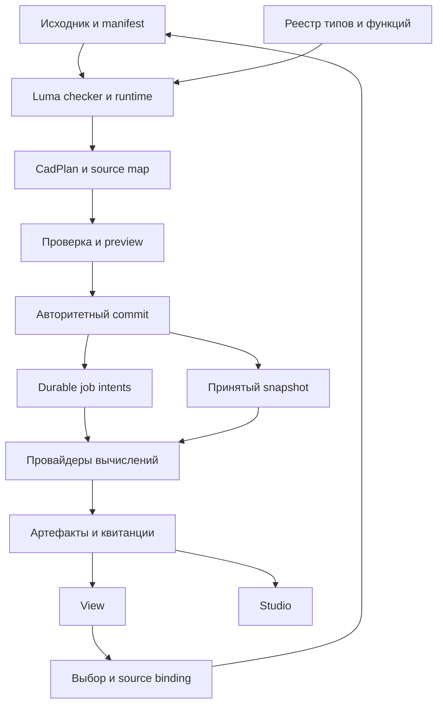
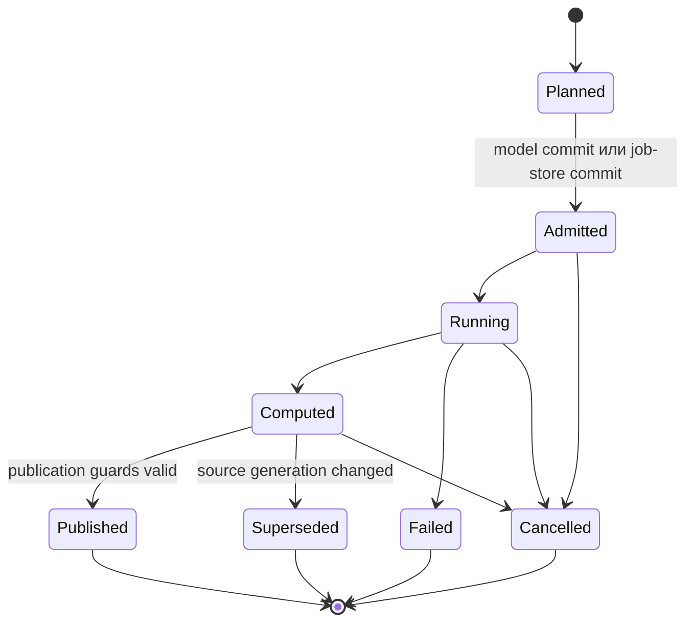

# Luma CAD — спецификация программной разработки

**Идентификатор:** LCAD-SPEC-001  
**Версия документа:** 1.0  
**Дата:** 25 ноября 2026 года, Europe/Moscow  
**Статус:** проект нормативной спецификации для поэтапной реализации  
**Язык реализации:** Rust; веб-интеграция через существующие HTTP/WASM-контракты  
**Основной репозиторий языка:** `maxmurtazin/luma-lang`  
**Область:** Luma, Living IR Core, 2D, B-rep, voxel, simulation, View, Product Studio, Elements.

Согласованное продуктовое решение: **Luma служит одновременно авторским рецептом детали/сборки и языком команд над существующим инженерным проектом.** Оба режима используют общий набор типов, операций, диагностики и адаптеров. Различаются владение сущностями, входной контекст и правила применения изменений.

Документ определяет целевую реализацию. Имена новых API, CLI-команд, схем и профилей ниже являются проектными контрактами, а не заявлением об их наличии в Luma 0.1.3. Подтверждённая исходная база отдельно зафиксирована в разделе 2. Наличие кода в backend, наличие адаптера, наличие Luma binding и сквозная квалификация учитываются раздельно.

## Содержание

- [1. Назначение и область первой версии](#sec-01)
- [2. Подтверждённая исходная база](#sec-02)
- [3. Термины и модель ответственности](#sec-03)
- [4. Архитектура и размещение компонентов](#sec-04)
- [5. Профили исполнения и выбор режима](#sec-05)
- [6. Расширение языка и host registry](#sec-06)
- [7. Типы, единицы и координаты](#sec-07)
- [8. Параметры и граф выражений](#sec-08)
- [9. Режим авторского рецепта](#sec-09)
- [10. Режим команд над существующим проектом](#sec-10)
- [11. Подготовка плана, preview и commit](#sec-11)
- [12. Сохранение исходника, идемпотентность и восстановление](#sec-12)
- [13. Идентичность и семантические ссылки](#sec-13)
- [14. Задания и артефакты](#sec-14)
- [15. Capabilities, версии и комплект совместимости](#sec-15)
- [16. Core, CAD features, implicit и lattice](#sec-16)
- [17. B-rep и преобразования представлений](#sec-17)
- [18. Voxel](#sec-18)
- [19. Sketch, Draft и Drawing](#sec-19)
- [20. Assembly и Elements](#sec-20)
- [21. Simulation](#sec-21)
- [22. View и инженерное отображение](#sec-22)
- [23. Product Studio и render](#sec-23)
- [24. Импорт, экспорт и внешние ресурсы](#sec-24)
- [25. CLI и встраиваемый API](#sec-25)
- [26. Редактор, source mapping и AI/MCP](#sec-26)
- [27. Машинные контракты и диагностика](#sec-27)
- [28. Канонизация, хеши и воспроизводимость](#sec-28)
- [29. Ресурсы, изоляция и эксплуатация](#sec-29)
- [30. Стратегия проверки и матрица приёмки](#sec-30)
- [31. Производительность и целевые платформы](#sec-31)
- [32. Этапы разработки и критерии выхода](#sec-32)
- [33. Документация, совместимость и выпуск](#sec-33)
- [34. Зафиксированные решения и границы дальнейшего развития](#sec-34)
- [Приложение A. Минимальная поверхность API](#appendix-a)
- [Приложение B. Примеры целевого языка](#appendix-b)
- [Приложение C. Примеры протокола](#appendix-c)
- [Приложение D. Источники и закреплённые контракты](#appendix-d)

<a id="sec-01"></a>
## 1. Назначение и область первой версии

Luma CAD предоставляет процедурное описание инженерных моделей и автоматизации через существующие функции, модули и конвейеры Luma. Численные методы и геометрические алгоритмы исполняют профильные ядра. Core хранит принятые авторские определения и их историю; производные артефакты содержат точные ссылки на исходные ревизии.

Целевые пользователи: разработчик CAD, инженер, автор параметрического компонента, разработчик библиотеки элементов и AI/MCP-клиент, выполняющий те же типизированные операции, что интерфейс пользователя.

Обязательная область спецификации охватывает оба режима, типы и единицы, параметры, стабильные идентификаторы, планы и транзакции, задания, все девять репозиториев, CLI/редактор, совместимость, документацию и приёмку. Реализация разделена на этапы CAD-0…CAD-6. Принятие CAD-1 не означает готовности всех последующих этапов.

Слова **ДОЛЖЕН / НЕ ДОЛЖЕН** задают обязательные требования, **СЛЕДУЕТ** — рекомендуемый способ, **МОЖЕТ** — разрешённую вариативность. Обязательное требование к будущему этапу становится воротами выпуска этого этапа. Изменение его смысла оформляется новой версией спецификации и ADR.

| ID | Нормативное требование | Проверки |
| --- | --- | --- |
| LCAD-MODE-01 | Поддержать два явно выбранных режима `recipe` и `command`; не определять режим по тексту программы или текущему выделению UI. | AT-001, AT-018 |
| LCAD-MODE-02 | Сохранить существующие программы, `check`, `run`, `ir` и Graph Explorer в их прежних поддерживаемых профилях. | AT-002, AT-060 |
| LCAD-MODE-03 | Сохранять различие между текущей реализацией backend, адаптером, binding и квалифицированным сквозным маршрутом. | AT-003, AT-061 |

В первую версию языка не входят пользовательские классы, перегрузка функций, общий async-синтаксис, произвольная генерация WGSL, универсальный автоматический обратный перевод модели в код, распределённая атомарная транзакция нескольких независимых хранилищ и универсальная конверсия mesh/voxel в аналитический B-rep. Новые геометрические возможности развиваются в соответствующих ядрах и отдельно открываются через capabilities.

<a id="sec-02"></a>
## 2. Подтверждённая исходная база

Срез получен чтением исходников, манифестов и репозиторных документов на 25 ноября 2026 года. Указанные SHA повторно проверены при подготовке спецификации. Это опорная база проектирования; таблица не является результатом нового запуска сборок и тестов и не объявляет перечисленные `main` совместимым комплектом.

| Репозиторий | Зафиксированный commit | Наблюдаемый контракт и граница |
| --- | --- | --- |
| `luma-lang` | `4b7a200c8ec248a18c5d1ba1c470f1a5092dc0d5` | Cargo 0.1.3; ограниченный интерпретатор, мономорфный вывод типов, S1 read-only snapshot. Публичного host registry/CAD binding нет. [S01], [S02], [S03] |
| `living-ir-core` | `e8d5a465dbc943b746ce9f3607fe526f1b3a93df` | Canonical HIR, снимки/CAS, проектное хранение, параметры, F-Rep/features, sketch, assembly, lattice; доступность маршрутов зависит от профиля. [S05], [S06] |
| `living-ir-2d` | `1a39445c84c3585dd39c3992f256ce86f1da62c6` | Автономные Draft/Sketch/Sheets, профили и обмен. Полная интегрированная запись через Core остаётся отдельными воротами. [S09], [S10], [S11] |
| `living-brep-core` | `e1c266a18d77259b50f9269279e6a48559e5db08` | Нормальная экструзия профиля, проверки/запросы/mesh/native CBOR; отдельный M7 planar Boolean и нативный publication adapter. [S12], [S13], [S14] |
| `living-voxel-core` | `c17511db9258c1d06100c21b34ff0c03bb469b41` | CPU-профили V1–V5A, поля/маски, surface/slice, CAE exchange, paged storage и ограниченная adaptive geometry. [S15], [S16], [S17] |
| `living-simulation-core` | `c906f43a052fd918f33b94965045f449d3468544` | Экспериментальные solver-профили. Адаптер Core интегрирует stationary heat/diffusion/DC; F-Rep projection принимает Box. [S18], [S19] |
| `living-ir-view` | `a94fe6cca6f1d2982bb85e4cd4170422ba77f7b4` | Rust/wgpu/WebGPU, mesh, ограниченный GPU IR/lattice, B-rep publication/picking, capture. Voxel volume renderer не входит в подтверждённый V0–V5. [S20], [S21], [S22] |
| `illusion-maker-product-studio` | `938eafee7a6b1f0c2a9a00d98814a33b457dd33d` | Rust-модель/SQLite, WebGL2 preview, Blender Cycles CPU, PNG/MP4, source pin/rebind и timeline. [S23], [S24], [S25] |
| `living-ir-elements` | `13b06f7ad2885385e27b81d5ee0f118e89217cb0` | Локальные пакеты/каталог, параметры, размещение и сборки, BOM/раскрой; запись Elements в Core требует регистрации состояния и приёмки. [S26], [S27] |

Дополнительная заготовка: Luma Draft PR №1 `s2-validated-edits`, commit `f2a7db44e60e9fff285e3b5e0caf5b3c4295353e`, содержит `Workspace`/`DiskWorkspace`, preview/commit и ограниченные структурные правки. Она не входит в указанный `main`, не является общим CAD-редактором и не обеспечивает транзакцию с Core. [S04]

Подтверждённые интеграционные опоры:

- Core → B-rep: нормальная экструзия и публикация по актуальной ревизии; результат/геометрия/квитанция находятся в отдельном производном хранилище. [S07], [S14]
- Core → voxel pilot: публикация готового LVX, поколения слота, limited block patches/Undo и защита от stale/ABA. Это не общий мост произвольной CAD-геометрии в voxel. [S08]
- Core → simulation: адаптер с typed slots `geometry/material/boundaries`, snapshot-aware исполнением и durable publication. [S19]
- Core → View: отдельная интеграция на закреплённом Core; Studio использует собственный source contract и другой renderer backend. [S20], [S24], [S25]

При CAD-0 формируется новый проверяемый `luma-cad.lock.json`: он выбирает совместимые adapter/backend ревизии и targets. Установка всех последних `main` не заменяет этот шаг. Историческая capability-матрица в README не считается текущей автоматически: для каждой строки проверяются исходник/manifest и область квалификации.

<a id="sec-03"></a>
## 3. Термины и модель ответственности

| Термин | Значение |
| --- | --- |
| RecipeDefinition | Версионируемый исходный bundle Luma с entry, manifest, объявленными входами и outputs. |
| RecipeInstance | Экземпляр рецепта в проекте со своим UUID, binding входов, overrides и областью владения сущностями. |
| StableKey | Явный ключ авторского объекта внутри RecipeInstance; не имя переменной и не номер строки. |
| CommandRun | Одно выполнение сценария над закреплённым контекстом существующего проекта. |
| SourceRevision | Идентичность исходного bundle/редакторской ревизии; отличается от ModelRevision. |
| ModelRevision | Монотонная ревизия авторитетного документа/проекта; возврат прежних значений не возвращает старый номер. |
| Candidate / CadPlan | Проверяемое описание предполагаемых изменений с read set, write set, причинами, source map и job/view intents. |
| AcceptedSource | Точный source bundle, из которого получена принятая модельная ревизия. |
| SourcePin | Неизменяемая ссылка на ревизию/контент внешнего или внутреннего источника. |
| Artifact | Производный неизменяемый результат: mesh, LVX, расчёт, изображение, отчёт. |
| Capability | Возможность конкретного backend/profile/target; не разрешение пользователя. |
| Authority | Сервис/хранилище, которое вправе принять изменение конкретного документа. |
| Qualified | Сквозной маршрут прошёл перечисленные проверки на указанной платформе и наборе версий. |

| Данные | Авторитетный владелец в целевом интегрированном профиле |
| --- | --- |
| Детали, параметры, feature graph, экземпляры сборки, история | Core ProjectStore / согласованный canonical document contract |
| RecipeInstance, registry StableKey→EntityId, accepted source refs, parameter overrides | Та же проектная транзакция Core; требуется новая типизированная интеграция |
| Рабочий текст в редакторе | Source workspace; имеет собственную непринятую ревизию |
| Принятый текст рецепта | Неизменяемый bundle, закреплённый в квитанции Core |
| Derived voxel/B-rep/simulation artifacts | Соответствующее artifact/publication хранилище, связанное SourcePin |
| Presentation, timeline, appearance | Product Studio в пределах своей ревизии |
| Камера текущего viewport, hover, temporary selection | View/session state; не изменяет CAD-определение |
| Каталожный пакет элемента | Elements package authority с точной ревизией/digest |

Автономные 2D/Elements/Studio сохраняют своих владельцев. Пока нет общего host commit, такие операции выполняются в отдельной target authority и не рекламируются как часть одной атомарной Core-транзакции.

<a id="sec-04"></a>
## 4. Архитектура и размещение компонентов



Предлагаемая логическая декомпозиция:

| Компонент | Ответственность | Размещение |
| --- | --- | --- |
| `luma-host-api` | Типы host descriptors, эффекты, runtime handles, диагностика, бюджеты | Независимый crate в `luma-lang` |
| Расширение checker/runtime | Разрешение host imports, проверка вызовов, исполнение в PlanBuilder | `luma-lang`, с сохранением старых entry points |
| `luma-cad-contract` | Стабильные DTO, типы/operation IDs, codecs, manifest/schema generation | Без обязательной зависимости от private backend crates |
| `luma-cad-engine` | Recipe reconciliation, command planner, refs, hashes, common validators | Интеграционный слой; место фиксируется CAD-0 ADR |
| Core host adapter | Snapshot/prepare/commit, identity registry, outbox/receipts | `living-ir-core/integrations/luma-cad` или отдельный интеграционный workspace |
| Domain adapters | Типизированное преобразование к API соответствующего ядра | Рядом с владельцем интеграционного контракта |
| CLI/editor adapter | Команды, UI bridge, диагностика, source mapping | Luma CLI и существующий CAD/редактор |

Это логическая структура; допустимо объединить мелкие crates на первом этапе. Нельзя создавать цикл зависимостей `Luma ↔ Core` или требовать доступ к каждому backend для сборки общего интерпретатора. Межпроцессная граница использует DTO, а не сериализацию внутренних Rust enum без версии.

Геометрические методы не дублируются в Luma. Host registry маршрутизирует один operation contract к проверенному provider. Манифест не может сам загрузить произвольную библиотеку, executable или shader по непроверенному пути.

<a id="sec-05"></a>
## 5. Профили исполнения и выбор режима

`ExecutionRequest` задаёт `mode`, `target`, `profile`, точный source bundle, context snapshot и requested limits. Mode отсутствует в грамматике `.luma`: один и тот же синтаксис может использоваться в разных окружениях, но доступные эффекты различаются.

| Свойство | Recipe | Command |
| --- | --- | --- |
| Вход | RecipeDefinition, RecipeInstance, bindings, overrides, base revision | Source bundle, явные target refs, selection snapshot, base revision |
| Результат | Полное желаемое состояние принадлежащей рецепту области | Конечный упорядоченный набор команд над разрешёнными targets |
| Идентичность новых сущностей | `instance_id + stable_key + kind` через registry | Явный command-local key → stable ID через подготовленный план |
| Повтор запуска | Reconciliation с прежним принятым рецептом | Новый запрос либо повтор прежнего operation ID |
| Отсутствие объекта в программе | Возможное удаление только owned-сущности после проверки зависимостей | Ничего не удаляет |
| Внешние объекты | Чтение через явные pins; изменение запрещено без отдельного command | Изменение только объявленных writable targets |
| Произвольное текущее выделение | Недоступно | Передаётся в admission как неизменяемый selection snapshot |

В v1 одна подготовка/применение имеет **одну transaction authority**. `target.kind` различает `core_project`, `standalone_2d`, `standalone_elements`, `presentation` и `job_store`. Доступны только targets, для которых adapter реализует необходимые гарантии. Первый обязательный профиль — `luma.cad.core.native.v1`; остальные вводятся отдельными capability entries.

Композиция нескольких стадий оформляется явным workflow manifest: стадия модели выдаёт SourcePin, следующая стадия строит Presentation на этом pin, затем запускается render. Это последовательность принятых результатов с общей корреляцией, а не скрытая транзакция нескольких баз. Восстановление начинается с последней подтверждённой квитанции.

<a id="sec-06"></a>
## 6. Расширение языка и host registry

### 6.1. Синтаксис и импорты

Сохраняются `fn/end`, `object`, присваивание, массивы, `match`, `->` и `use name`. Пространства стандартных модулей: `cad`, `units`, `param`, `project`, `sketch`, `draft`, `drawing`, `implicit`, `brep`, `lattice`, `assembly`, `elements`, `voxel`, `sim`, `view`, `studio`, `render`, `jobs`, `artifact`.

В CAD-профиле импорт сначала разрешается по sealed registry стандартных модулей. Совпадение имени со sibling-файлом является `ModuleNameCollision`, а не скрытым выбором одного источника. В legacy-профиле прежний алгоритм sibling imports не меняется. Динамические import paths и сетевой package manager в v1 отсутствуют.

Классы и пользовательская перегрузка функций не добавляются. Типовая нотация `ParamRef<Length>` в этом документе описывает внутренний контракт, а не новый пользовательский generic-синтаксис. Именованные аргументы и запись `120 mm` не входят в MVP. Для настроек используются типизированные builder-функции/handles; обычные `object` остаются namespaces.

### 6.2. Descriptor

`HostFunctionDescriptor` содержит `qualified_name`, `operation_id`, `operation_version`, ordered parameters, result type, effect set, allowed modes/phases, capability predicates, diagnostic codes и provider binding. Descriptor проходит проверку уникальности и канонической сигнатуры до компиляции программы. Checker, interpreter, completion и документация используют один сериализованный источник.

Для встроенных физических операций descriptor поддерживает ограниченную native type scheme: dimension/kind variables инстанцируются заново на каждый прямой host call, с явными constraints и вычислением result dimension. Lifting Quantity/ParamRef в ParamExpr разрешается только перечисленной схемой. Это не пользовательская перегрузка: обычные `fn` остаются мономорфными, host functions не становятся произвольно передаваемыми полиморфными значениями. Ошибка инстанциации выдаётся checker до обращения к backend.

Эффекты v1: `Pure`, `ReadPinned`, `BuildPlan`, `DeclareTask`, `ViewIntent`, `ExternalRead`. `CommitModel`, `PublishArtifact`, `WriteFile` и `StartWorker` принадлежат host executor и не доступны как произвольный callback из стадии подготовки. Неизвестный effect запрещён, а `not_flagged` из S1 не считается доказательством допустимости.

### 6.3. Runtime API

Проектный Rust entry point: `run_with_host(source_bundle, execution_context, host_registry, budget) -> ExecutionResult`. Результат содержит typed outputs, prepared plan/reference, diagnostics, source map, view/task intents и consumed-resource report. `print` остаётся текстовым диагностическим каналом и не является машинным CAD-протоколом.

Старый `runtime::run(path)` сохраняется. `luma ir` v1 не получает скрыто новые варианты типов: для host-aware snapshot вводится новая версия схемы и явная команда/параметр, согласованные с разделом 33.

| ID | Нормативное требование | Проверки |
| --- | --- | --- |
| LCAD-HOST-01 | Одна registry definition задаёт типы/effects для checker и runtime; их расхождение блокирует загрузку профиля. | AT-004 |
| LCAD-HOST-02 | CAD imports разрешаются детерминированно; конфликт локального и host-модуля даёт явную ошибку. | AT-005 |
| LCAD-HOST-03 | Во время prepare запрещены скрытые commits, запись файлов, запуск worker и произвольные сетевые запросы. | AT-006, AT-029 |
| LCAD-HOST-04 | `run_with_host` возвращает структурный результат; stdout/print не парсится для получения модели. | AT-004, AT-059 |
| LCAD-HOST-05 | `parallel` не клонирует mutable CAD-сессию. В v1 разрешены только проверенные чистые callback-вычисления без host mutation и job submission. | AT-007 |

<a id="sec-07"></a>
## 7. Типы, единицы и координаты

### 7.1. Числа и величины

Сохраняется конечный binary64 `Number`. NaN/±Infinity отклоняются на всех входах и после арифметики. UUID, ревизии, поколения, размеры blob и большие целочисленные счётчики передаются отдельными opaque/integer DTO либо десятичными строками на wire; они не помещаются в `Number` с потерей точности.

`Quantity` включает значение SI, dimension ID и quantity kind. Dimension описывает физическую размерность; kind различает угол, безразмерный коэффициент, абсолютную температуру и перепад. `Unit` существующей Luma продолжает обозначать отсутствие значения.

MVP-конструкторы: `units.m`, `units.cm`, `units.mm`, `units.inch`, `units.rad`, `units.deg`, `units.seconds`, `units.kelvin`, `units.celsius`, `units.delta_kelvin`. Дополнительные инженерные величины вводятся registry-driven constructors, например pressure/conductivity/density. Неизвестная единица не считается SI.

Абсолютная температура преобразуется с offset; разность абсолютных температур даёт перепад; абсолютная температура плюс перепад даёт абсолютную температуру. Сложение двух абсолютных температур и использование перепада вместо absolute boundary запрещаются. Эти правила реализуются проверкой kind, не только dimension.

Для первой версии арифметика Quantity и параметров выполняется явными функциями `units.add/subtract/multiply/divide` и `param.*`. Операторное расширение `+ - * /` на эти типы допускается позже отдельной language capability; обычная арифметика Number не меняется.

### 7.2. Геометрические и доменные типы

`Point2`, `Point3`, `Vector3`, `Direction3`, `FrameRef`, `Pose3`, `PlaneRef`, `AxisRef`, `Bounds3` имеют явные frame/units. Каноническая мировая система — правая, длины в метрах, углы в радианах; UI display units не меняют семантику. Преобразование к координатам renderer задаётся адаптером и входит в контракт сцены.

Авторские handles: `PartRef`, `FeatureRef`, `ParameterRef`, `SketchRef`, `DraftRef`, `DrawingRef`, `AssemblyRef`, `OccurrenceRef`, `ElementRef`, `StudyRef`, `PresentationRef`. Представления: `ProfileRef`, `BodyRef`, `ImplicitRef`, `BrepRef`, `VolumeRef`, `MeshRef`, `FieldRef`, `SectionRef`. Выполнение: `TaskSpecRef`, `JobIntentRef`, `JobRef`, `ArtifactRef`, `QueryResultRef`, `OutcomeRef`.

`BodyRef` — типизированный результат solid-операции с известным provider/profile; он не означает наличие B-rep, voxel и exact distance одновременно. Общие query-функции требуют конкретной операции у этого provider. Имплицитное приведение между математическими представлениями отсутствует.

Handles содержат проверяемую принадлежность authority/project/revision и тип. Внутренний индекс arena не является сериализуемым ID. Однородные массивы handles допустимы только внутри одной совместимой runtime type signature; объединение разных representation types требует явного контрактного типа, а не динамической потери проверки.

Различаются `PinnedRef { authority, project, revision, entity_id, type }` для принятого объекта и `PlanRef { preparation_scope, logical_key, producer_output, type }` для объекта кандидата. Новая декларация возвращает PlanRef; он разрешается только внутри своего candidate environment. Он не требует ещё не существующей принятой revision. Commit возвращает сохранённое mapping `PlanRef → PinnedRef`; job intents на новые объекты связываются с новым принятым snapshot. Наружу как persistent reference PlanRef не передаётся. В canonical hash используется logical key/producer output, а не случайный preparation scope или arena index.

| ID | Нормативное требование | Проверки |
| --- | --- | --- |
| LCAD-TYPE-01 | Проверять finite значения, размерности, quantity kinds и integer ranges до исполнения backend. | AT-008, AT-009 |
| LCAD-TYPE-02 | Явно хранить единицы/frame/layout и применять подтверждённое преобразование на границе provider. | AT-010, AT-042 |
| LCAD-TYPE-03 | Проверять тип, authority, scope и revision каждого opaque handle; чужой handle не разрешается по одному совпавшему UUID. | AT-011 |
| LCAD-TYPE-04 | Запретить неявное представление ID/revision как f64 и неявное превращение display mesh в авторский solid. | AT-009, AT-035 |

<a id="sec-08"></a>
## 8. Параметры и граф выражений

### 8.1. Объявление и эффективное значение

`param.length(key, default_quantity)` создаёт декларацию и возвращает `ParamRef<Length>`. Аналогично действуют `angle`, `scalar`, `count`, `boolean`, затем дополнительные quantities. `key` стабилен внутри RecipeInstance. Декларация включает type, default, optional min/max, exposure policy и human-readable label.

Эффективное значение равно закреплённому instance override, если он есть; иначе используется default текущей декларации. Command/UI `param.set(ref, value)` меняет override. `param.reset(ref)` снимает override. Повторный запуск рецепта сохраняет override. Правка default в исходнике применяется только к параметру без override; preview показывает default, override и effective value раздельно.

Смена типа или размерности по существующему key — `ParameterTypeMigrationRequired`. Переименование key — удаление/создание, если не приложена явная migration map. Не допускается молчаливое приравнивание параметров по похожим именам.

Новые bounds проверяют и существующий override. Если он перестал подходить, кандидат отклоняется без clamp/reset. Удаление декларации с override возвращает `OverrideOrphaned`, пока atomic plan явно не снимает или не мигрирует override. Сохранённый tombstone не должен скрыто восстанавливать старую настройку при последующем reuse key.

### 8.2. Выражения

MVP использует явные `param.add`, `param.subtract`, `param.scale`, `param.divide_scalar`, `param.negate`. Константы Quantity автоматически поднимаются в типизированный literal expression внутри этих функций. Дополнительные multiply/divide, min/max и функции добавляются только при наличии проверенного lowering и правил размерности.

`ParamExpr` хранит DAG, declared dependencies, dimension/kind, operation version и source span. Численное значение не заменяет граф. Результат передаётся в Symbolic/native parameter representation только для поддерживаемого подмножества. Цикл, несовместимые типы или неподдерживаемый узел дают ошибку до commit.

`param.value(ref)` явно материализует эффективное значение: Quantity для физической величины, Bool для boolean, проверенный целый Number в диапазоне 0…2^53−1 для Count MVP, Number для scalar. Для PlanRef используется candidate declaration + admitted instance override; для внешнего PinnedRef — закреплённый input; в command действует read-your-writes через упорядоченный overlay. Дальнейшие вычисления/ветвления являются зависимостью recipe execution и не рекламируются как автоматически перенесённый Symbolic DAG.

Command `param.set/reset` запускает подготовку всех затронутых recipe instances из их точных AcceptedSource bundles. Planner применяет изменения в overlay, перестраивает их desired sets и включает reconciliation в тот же atomic candidate. При нескольких set одного batch сначала фиксируются финальные overrides, затем recipe closure пересчитывается топологически; явное промежуточное `param.value` читает текущий overlay, а геометрические outputs считаются окончательно подготовленными после reconciliation. Любая ошибка rerun отклоняет и overrides, и generated changes. Native ParamExpr-only dependencies могут пересчитываться без исполнения recipe, если dependency analysis это доказывает. Цикл recipe dependencies или выход за разрешённый authority/scope блокирует apply. Исходник CommandRun сохраняется отдельно и не заменяет AcceptedSource самого рецепта.

Зависимость, определяющая число создаваемых объектов, относится к recipe rebuild. Например, изменение count массива крепежа пересобирает recipe-owned область. StableKey отдельных экземпляров определяется логическим ключом элемента, а не порядком обхода изменившегося массива.

| ID | Нормативное требование | Проверки |
| --- | --- | --- |
| LCAD-PARAM-01 | Сохранять default и instance override раздельно; rerun не стирает пользовательский override. | AT-012 |
| LCAD-PARAM-02 | Сохранять ParamExpr DAG и зависимости; отличать native parameter rebuild от recipe re-execution. | AT-013, AT-014 |
| LCAD-PARAM-03 | Смена типа/размерности и неоднозначная migration key требуют явной миграции. | AT-015 |
| LCAD-PARAM-04 | Циклические/неподдерживаемые выражения не публикуются; численное вычисление не скрывает потерю зависимости. | AT-013, AT-016 |

<a id="sec-09"></a>
## 9. Режим авторского рецепта

### 9.1. Область владения

RecipeInstance получает UUID при создании и остаётся самостоятельной сущностью проекта. Каждая создаваемая декларация имеет `StableKey`: ASCII, от 1 до 128 байт, шаблон `^[a-z][a-z0-9_.:/-]{0,127}$`. Повтор ключа в одной owned namespace запрещён независимо от имени переменной. UUID выдаёт registry один раз и сохраняет после перестановки строк, комментариев и форматирования.

Уникальность registry определяется `(instance_id, entity_key)`. `entity_kind` — неизменяемый проверяемый атрибут записи, а не способ создать ещё одну сущность с тем же key. Повторное использование tombstoned key без explicit restore запрещено. Изменение kind по key требует migration. Random UUID, сгенерированный заново при каждом запуске, не является допустимым способом авторской идентичности.

`cad.output(key, ref)` объявляет публичный результат рецепта. Вывод не выполняет commit. Внешние потребители связываются с output и его source identity, а не с временным runtime handle.

Output keys имеют отдельную namespace `(instance_id, output_key)` с собственной устойчивой output identity. Совпадение entity key и output key допустимо, дубликат output key — ошибка. Смена типа/удаление output проверяет всех внешних потребителей и требует совместимой migration. В первом Core-профиле `cad.output` принимает BodyRef; прочие typed outputs вводятся самостоятельными descriptor signatures.

### 9.2. Reconciliation

Исполнение строит полный desired set в пределах RecipeInstance. Planner сравнивает его с предыдущей принятой версией и выдаёт create/update/reuse/remove. Изменение recipe source не имеет права удалить чужую деталь или объект, созданный командой вне managed region.

Только успешно завершённое валидное исполнение может сформировать пустой desired set. Ошибка source/import/type/runtime, отмена или incomplete bundle никогда не означают «удалить всё принадлежащее рецепту». Кандидат в этих случаях отсутствует.

Исчезнувшая owned-сущность удаляется только после проверки всех входящих ссылок, политики удаления и outputs. Если на неё ссылаются другой рецепт, сборка, чертёж или расчёт, по умолчанию весь кандидат блокируется `ReferencedEntityRemoval`. Разрешённая cascade/retarget операция должна быть явной и перечислять затрагиваемые owned targets в плане.

Изменение внутренней геометрии рецепта внешней командой запрещено `ManagedEntityConflict`. Доступны опубликованные параметры/контрактные overrides. Для независимого редактирования существует явный `DetachRecipeRegion`: он фиксирует финальные определения, снимает управление рецептом выбранной областью и возвращает отчёт о разорванных авторских связях. Частичное detach разрешается только при замкнутом write set и проверенных зависимостях; MVP может поддерживать только полный instance detach.

### 9.3. Внешние входы и повторение

Все внешние входы перечислены в bindings: pinned part revision, element package, immutable asset либо admitted read of another project entity. Доступ к текущему head происходит на admission; во время исполнения значение не меняется. Внешний authoritative head, который нельзя атомарно проверить при commit, допускается только как удерживаемый immutable pin. Строгий live-head contract в таком случае отклоняется.

Для зависимостей recipe→recipe различаются `exact_pinned` и `follow_current`. Exact pin остаётся на исходной ревизии и не включает consumer в affected closure при изменении producer. Follow-current допустим только внутри одной transaction authority: admission snapshot задаёт исходный read guard, затем после пересчёта producer consumer читает его candidate PlanRef/output, а вся closure принимается согласованно. Это явное чтение собственного overlay, не произвольная смена внешнего источника во время run. Внешний follow-current без такой гарантии отклоняется либо требует явного exact pin.

При одинаковых source bundle, bindings, effective parameters, registry versions и numerical profiles строится одинаковый canonical semantic plan. Preview geometry может иметь другую упаковку байтов только в пределах явно заявленной reproducibility policy; это не меняет ключ входной семантики.

Повтор точно принятого состояния даёт `NoChange` с квитанцией текущей ревизии. Изменение source bundle даже без изменения геометрии требует записи новой provenance/recipe revision; geometry artifacts могут переиспользоваться по semantic keys. Это сохраняет точную связь принятой модели с исходником.

| ID | Нормативное требование | Проверки |
| --- | --- | --- |
| LCAD-REC-01 | StableKey registry и UUID переживают нерелевантные правки source; duplicate/kind reuse/tombstone reuse не обходят идентичность. | AT-017 |
| LCAD-REC-02 | Reconciliation ограничен owned region; удаление с внешними ссылками блокируется целиком. | AT-019, AT-020 |
| LCAD-REC-03 | Прямое изменение managed internals запрещено; override/detach выполняются явными типизированными командами. | AT-021 |
| LCAD-REC-04 | Входы рецепта закрепляются; mutable external head без атомарной проверки не выдаётся за защищённую зависимость. | AT-022 |
| LCAD-REC-05 | Exact rerun возвращает NoChange; новый принятый source digest сохраняется даже при reuse геометрии. | AT-023 |

<a id="sec-10"></a>
## 10. Режим команд над существующим проектом

CommandContext содержит project/document IDs, admitted revision tokens, explicit writable target IDs, immutable selection, actor scope и captured inputs. Сценарий обращается к данным через `project.*`, `param.*` и соответствующие доменные функции. Изменение выбора в UI после admission не меняет смысл запущенного сценария.

Команда строит упорядоченный patch, а не новый полный desired set. Если объект не упомянут, он не меняется. `project.part(id)` и `project.parameter(part, key)` разрешаются только в пределах допущенного контекста. Поиск по отображаемому имени не заменяет идентификатор; неоднозначность требует уточнения через typed selector до изменения.

`expected_revision` относится к документу/части, а read guards — ко всем данным, влияющим на команду. В первой реализации допустим консервативный CAS всего проекта. Позже per-part guards разрешаются только если ProjectStore обеспечивает атомарность всех read/write guards. Консервативный отказ из-за правки другой детали отражается как ограничение профиля, а не скрытая автоматическая перезапись.

Команда над параметром рецепта изменяет override по разделу 8. Команда удаления, detach или смены источника должна содержать соответствующую operation; общего `force` для обхода проверок нет. Политика UI может запросить подтверждение разрушительного изменения, но обязательность подтверждения не смешивается с математической допустимостью/CAS.

| ID | Нормативное требование | Проверки |
| --- | --- | --- |
| LCAD-CMD-01 | Использовать явные targets и snapshot selection; не читать изменяемое ambient UI selection в середине run. | AT-018 |
| LCAD-CMD-02 | Применять только перечисленные operations; отсутствие сущности в source не означает её удаление. | AT-024 |
| LCAD-CMD-03 | Проверять ownership, actor grants и все read/write guards до commit. | AT-011, AT-025 |
| LCAD-CMD-04 | Destructive operations и detach имеют собственные контракты/диагностику; общий force bypass запрещён. | AT-020, AT-021 |

<a id="sec-11"></a>
## 11. Подготовка плана, preview и commit

### 11.1. CadPlan

Обязательные поля: schema/version, mode, target authority, base revision, source bundle digest, registry/lock digest, recipe instance либо command context ID, typed operations, effective parameter bindings, source_read_set, write_set, ownership delta, source map, task/view intents, limits, diagnostics и canonical plan digest.

Read guard задаёт один из видов: `DocumentHead(revision, definition_digest)`, `PinnedDocument(revision, digest, retention_token)`, `Artifact(digest, schema)`, `Package(revision, digest)` или `CapturedResource(digest, generation)`. Все guards связаны с authority/scope; одинаковый UUID в разных проектах не создаёт равенство. Для head guard возврат прежнего содержимого сохраняет конфликт по поколению.

Prepared candidate содержит полноту проверки: `Validated`, `Rejected`, `Unresolved`, `Cancelled`, `LimitExceeded`. Неопределённость и неподдержка не дают пустой успешный patch. Partial preview разрешён для диагностики, но не пригоден для commit как полный кандидат.

### 11.2. Этапы

1. **Admission:** проверка доступа, source, registry, target и начальных limits; snapshot capture.
2. **Check:** синтаксис, типы, imports, effects, profiles.
3. **Plan:** исполнение bounded Luma, reconciliation/command patch, dependency reads.
4. **Prepare:** доменная валидация и ограниченное вычисление кандидата; generation keys закреплены.
5. **Preview:** отображение кандидата с собственной candidate identity, diagnostic/source provenance.
6. **Commit:** повторная проверка guards, текущих прав, отмены и digest; единая авторитетная запись.
7. **Post-commit:** delivery durable intents и обновление подписчиков по подтверждённой квитанции.

Commit принимает `prepared_plan_id`, `candidate_digest`, `expected_revision`, `operation_id`, `request_digest`. Он не принимает произвольный изменённый план вместо подготовленного. План хранится host-слоем или передаётся с проверяемым canonical envelope; истёкший/вытесненный candidate требует prepare заново.

Atomic write включает изменения определения, identity registry/ownership, overrides, accepted-source reference, history, receipt и outbox intents. Ошибка до commit point не оставляет часть этих данных принятой. Подготовленные большие immutable blobs могут существовать до commit, но не становятся достижимыми публикациями без принятой ссылки.

Cancel и model commit имеют линейный порядок внутри authority. До commit point отмена оставляет старое состояние; после него результат — accepted receipt либо `CommitUncertain` с исходным operation_id, если доставка ответа нарушена. Возвращать обычный `Cancelled/Rejected` со смыслом «изменений нет» после принятого commit запрещено. Ошибка subscriber/view/outbox delivery не отменяет принятую модель и отображается отдельным delivery outcome.

Для multi-authority workflow commit одной стадии не откатывается автоматически из-за отказа следующей. Результат явно показывает принятые стадии, failed stage и возможность повторения. Необратимый внешний side effect не маскируется откатом UI.

| ID | Нормативное требование | Проверки |
| --- | --- | --- |
| LCAD-TXN-01 | CadPlan хранит все semantic reads/writes, source/lock digests, ownership и intents; скрытые чтения запрещены. | AT-022, AT-026 |
| LCAD-TXN-02 | Preview не принимает модель; commit связан с exact validated candidate и повторно проверяет guards/доступ. | AT-025, AT-027 |
| LCAD-TXN-03 | Определение, registry, overrides, source pin, receipt и outbox записываются атомарно у одного authority. | AT-028 |
| LCAD-TXN-04 | Ошибка/отмена/неопределённость одной обязательной операции блокирует весь atomic batch. | AT-016, AT-029 |
| LCAD-TXN-05 | Любой cross-authority workflow раскрывает стадии; distributed atomicity не предполагается. | AT-030 |

<a id="sec-12"></a>
## 12. Сохранение исходника, идемпотентность и восстановление

### 12.1. Две независимые ревизии

Workspace хранит редактируемый source. Core хранит exact AcceptedSource bundle по каждой принятой recipe revision. Сохранение файла не обновляет модель автоматически. UI различает `SourceModified`, `Checked`, `PreviewReady`, `ModelAccepted`, `SourceAheadOfModel`, `Conflict`, `RecoveryRequired`.

Для принятия модели stage immutable source blob сначала полностью записывается и проверяется по digest. Core commit удерживает ссылку/GC root вместе с model receipt. Восстановление принятой модели не зависит от того, что пользователь позднее изменил исходный `.luma` файл. Внешняя filesystem-транзакция S2 не является commit point Core. При невозможности сохранить source bundle commit модели запрещён.

Typed `LumaRecipeState`/receipt contract должен быть зарегистрирован в Core; вставка незарегистрированного расширения в canonical document недопустима. Существующий запрет незарегистрированного Elements extension показывает необходимость реальной регистрации, а не сохранения произвольного JSON рядом с моделью. [S27]

### 12.2. Повтор запросов

Idempotency scope: `(authority_id, project_id, actor_or_service_scope, operation_id)`. UUID operation_id генерирует клиент один раз на логическое применение. `request_digest` включает mode, target, expected guards, source/plan digests, effective inputs, requested operations и политики. Токены доступа и транспортные retry counters в digest не входят.

Тот же scope/key + тот же request digest возвращает исходную квитанцию, включая исходную accepted revision. Тот же key + другой digest даёт `RequestReuse`. Получение квитанции повторно проверяет текущий доступ. Если источник изменился после принятия, replay не выполняет операцию заново и не выдаёт новую актуальность артефакта.

При транспортном timeout клиент сначала запрашивает receipt исходного operation_id. Состояние `CommitUncertain` не даёт права автоматически повторить изменение под новым ID. `NotFound` допускает повтор того же envelope после проверки контракта retention. Dedup identity принятого запроса сохраняется весь срок жизни проекта в v1, даже при сжатии истории. Допустима компактная receipt/tombstone запись, достаточная для предотвращения повторного эффекта. Более короткий срок требует нового negotiated epoch и явного отказа старому запросу, а не молчаливого исполнения заново.

### 12.3. Recovery и Undo

После crash восстанавливаются либо прежняя целостная ревизия, либо новая целостная ревизия с квитанцией. Outbox допускает at-least-once delivery; получатель обязан дедуплицировать operation/task key. Undo/Redo создают новое поколение активного состояния и сохраняют исторические pins; ABA не разрешает старой команде/публикации пройти CAS.

| ID | Нормативное требование | Проверки |
| --- | --- | --- |
| LCAD-DUR-01 | Сохранять exact accepted source независимо от mutable workspace; source save и model commit различимы. | AT-031, AT-032 |
| LCAD-DUR-02 | Повтор одного request возвращает ту же receipt; reuse ID с другим payload отклоняется. | AT-033 |
| LCAD-DUR-03 | Timeout разрешается через исходный operation_id; новый ID не создаётся автоматически при uncertain outcome. | AT-034 |
| LCAD-DUR-04 | Crash/restart сохраняет согласованность model/registry/source/receipt/outbox; Undo не устраняет ABA. | AT-028, AT-032, AT-036 |

<a id="sec-13"></a>
## 13. Идентичность и семантические ссылки

Source node ID S1 полезен для навигации, но может меняться при rename/move/структурной правке. Поэтому persistent model UUID хранится отдельно. Source binding содержит source bundle digest, file ID, half-open UTF-8 byte span, syntax ID, stable key и model entity ID. После правки spans разрешаются заново в новой ревизии. [S01]

`SemanticRef` содержит источник, ожидаемый тип/роль, selector, cardinality, source revision policy и последнее resolution evidence. Для выбираемой грани обязательны источник публикации, topology/geometry digest и область действия ordinal. Номер треугольника не используется как persistent face identity.

Cardinality `ExactlyOne` требует ровно одного результата. Ноль даёт `ReferenceMissing`, несколько — `ReferenceAmbiguous`. В автоматическом режиме нельзя выбирать ближайший результат вместо разрешения неоднозначности. Rebind показывает исходную и новую связь и создаёт новую проверяемую операцию.

Путь экземпляра сборки и идентичность детали различаются: два occurrences одной Part имеют разные placement/presentation bindings. Рекурсивный путь фиксируется на assembly snapshot. Циклическая сборка, неоднозначный member key и исчезнувший parent блокируют разрешение.

| ID | Нормативное требование | Проверки |
| --- | --- | --- |
| LCAD-ID-01 | Модельные IDs независимы от line/span/S1 ID; source map проверяется по exact source revision. | AT-017, AT-056 |
| LCAD-ID-02 | Геометрические ordinals действительны только в конкретном artifact; неоднозначный rebind не выполняется автоматически. | AT-037, AT-055 |
| LCAD-ID-03 | Part identity, occurrence path, feature output и representation artifact имеют отдельные области действия. | AT-038 |

<a id="sec-14"></a>
## 14. Задания и артефакты

### 14.1. Семантика функций в программе

Подготовка Luma не выполняет длительные post-commit задачи. `voxel.sample(...)`, `sim.solve(...)`, `render.still(...)` и аналогичные функции возвращают **TaskSpecRef** — immutable описание вычисления с типом будущего результата. `jobs.submit(key, task)` добавляет intent в candidate и возвращает **JobIntentRef**, действительный внутри плана. Intent становится durable только при atomic commit outbox/receipt. После commit executor выдаёт JobRef через ExecutionResult/receipt mapping.

TaskSpec может зависеть от другого TaskSpec в том же ациклическом task DAG. Такая зависимость — typed future-output slot, а не готовый MeshRef/ArtifactRef. Provider и типы входов/выходов проверяются до commit. Submit корневой задачи включает всю транзитивную closure её DAG; shared dependency с одинаковой logical identity ставится один раз. Worker запускается только после принятия зависимостей; failure/cancel upstream блокирует downstream. Полученный результат не превращается в доступное значение Luma в середине prepare.

Recipe intent имеет stable submit key в namespace RecipeInstance и fingerprint task/inputs/policy. Exact rerun с неизменным intent возвращает прежнее mapping, в том числе для pending/failed job, без повторного вычисления. Явный повтор — отдельная command `retry` с новой attempt identity. Изменившиеся inputs создают новую intent generation. Computed artifact может переиспользоваться по computation key, но новая current publication требует своих актуальных source guards.

Mapping JobIntentRef→JobRef назначается детерминированно при commit либо сохраняется как durable `PendingDelivery`. Receiver использует idempotent delivery key. Crash после enqueue и до ответа разрешается lookup по этому ключу, не повторной постановкой с новым ID.

`jobs.status(job)` и `jobs.result(job)` внутри prepare читают status/receipt, захваченные на admission, либо immutable published artifact. Live status читается host/UI вне prepare. Незавершённый job возвращает явное `Pending`, а не пустой артефакт. Ожидание реализуется host CLI/UI между исполнениями; скрытый `wait` внутри atomic prepare v1 запрещён. Будущая процедурная оркестрация с suspend/resume требует отдельного профиля; новый языковой async-синтаксис для v1 не нужен.

### 14.2. Состояния



`Computed` означает наличие проверенного вычислительного результата, но не его публикацию как текущего. `Published` содержит source pin и publication generation. Историческая доступность артефакта не означает его актуальность для текущей модели. Отказ численной сходимости, `Unresolved` или unsupported result topology сохраняется в domain outcome и не маскируется lifecycle статусом Completed.

### 14.3. Публикация и отмена

При `current_if_unchanged` проверяется source head/generation и expected output-slot generation; при `historical_pinned` публикация сохраняет источник как исторический и никогда не заменяет current slot без дополнительной проверки. Политика фиксируется в task spec, plan и receipt.

Cancel и publish имеют линейный порядок в publication authority. Cancel до publication commit запрещает публикацию. Cancel после неё возвращает `AlreadyPublished`, не удаляя результат. При cooperative provider отмена может завершить computation позже, но запрещённый результат не становится опубликованным. Принудительная остановка worker не является доказательством корректности частичного артефакта.

Artifact manifest содержит source refs, backend/build/operation/profile, exact blob digests, logical/semantic digests с версиями, frame/units, quality/coverage, domain outcome, task ID и publication receipt. Все blob bytes проверяются при импорте/восстановлении. Большие массивы не передаются через AST/print.

Для renderer допускается bounded отображение неполного preview с `completeness=partial`; такой артефакт не получает роль проверенного manufacturing/simulation input. Экспорт передаёт только результаты, разрешённые явной policy потребителя.

| ID | Нормативное требование | Проверки |
| --- | --- | --- |
| LCAD-JOB-01 | TaskSpec/JobIntent/JobRef различаются; prepare не запускает worker и не ожидает собственного post-commit job. | AT-006, AT-039 |
| LCAD-JOB-02 | Task DAG ацикличен; downstream использует только совместимые проверенные outputs и source pins. | AT-039, AT-047 |
| LCAD-JOB-03 | Computation, domain acceptance, current publication и historical availability различимы. | AT-040, AT-048 |
| LCAD-JOB-04 | Проверять publication generation/ABA; cancel/publish race имеет один наблюдаемый исход. | AT-036, AT-041 |
| LCAD-JOB-05 | Recovery проверяет digests и возобновляет только объявленный resumable profile; corrupt/partial output не публикуется. | AT-032, AT-050 |

<a id="sec-15"></a>
## 15. Capabilities, версии и комплект совместимости

Capability entry содержит: `capability_id`, `luma_operation`, signature/effects version, backend operation/version, adapter version, representation/input constraints, numerical profile, supported target, stages/statuses, required grants, limits, evidence refs и pinned commits.

Статусы по независимым осям:

| Ось | Значения |
| --- | --- |
| Backend | `absent`, `implemented`, `experimental`, `qualified_profile` |
| Adapter | `absent`, `implemented`, `qualified_profile` |
| Luma binding | `planned`, `implemented`, `qualified_profile` |
| Runtime availability | `available`, `unavailable`, `disabled`, `missing_dependency` |
| Input support | `supported`, `unsupported`, `requires_preflight` |
| Target verification | `not_run`, `passed`, `failed` с конкретным окружением |

Наличие разрешения пользователя не создаёт отсутствующую backend capability. Available route не означает прохождение E2E. Если input support требует preflight, capability response не обещает выполнение для любой геометрии.

`luma-cad.lock.json` фиксирует версии Luma, contract/schema, adapter/builds, provider commits/build fingerprints, supported targets и numerical profiles. Backend обновляется через новый lock, tests и migration record. При изменении fingerprint во время run подготовленный кандидат недействителен. Среда может иметь несколько разрешённых locks, но один run использует ровно один.

Не допускается скрытый approximate fallback. Переход B-rep→voxel или field→mesh разрешается только как отдельный conversion node с policy и отчётом потерь. Renderer может выбрать mesh fallback для отображения, сохранив representation/provenance/quality в кадре и не меняя авторскую модель.

| ID | Нормативное требование | Проверки |
| --- | --- | --- |
| LCAD-CAP-01 | Публиковать раздельные backend/adapter/binding/target статусы и фактические ограничения входа. | AT-003, AT-061 |
| LCAD-CAP-02 | Каждый plan/job закрепляет lock и provider fingerprints; смена provider делает старый candidate непригодным. | AT-026, AT-043 |
| LCAD-CAP-03 | Unsupported операция возвращает объяснимый отказ; скрытое изменение математического представления запрещено. | AT-035, AT-044 |
<a id="sec-16"></a>
## 16. Core, CAD features, implicit и lattice

Первый vertical slice использует существующие native параметры и операции пластины/отверстий Core. Расширение на Box/Sphere/Cylinder, extrusion/revolve, pocket, chamfer/fillet и другие features выполняется по capability manifest конкретного профиля. Сигнатура Luma не расширяет допустимый геометрический класс upstream операции. [S05], [S06]

Авторская операция создаёт definition/feature output; производные field/mesh artifacts не становятся вторым редактируемым деревом. Нижележащий provider может строить DerivedGraphPatch, но его IDs/provenance должны разрешаться к исходной feature и принятому snapshot.

`implicit` предоставляет поддержанные primitives/ordered CSG/field queries. Difference сохраняет порядок операндов. EmptySolid, неизвестное поле и failed computation различаются. GeneralField не объявляется точным SDF. При запрете конкретной distance query wrapper возвращает unsupported/uncertain outcome с исходным provider code.

`lattice` описывает kind, cell size, phase/orientation, thickness или porosity contract, region/clip source и effective numerical profile. Gyroid/BCC/Schwarz P/Diamond включаются только там, где upstream профиль их предоставляет. Нельзя считать отсутствие native CPU mesh/export у текущего lattice-пути решённым наличием GPU-preview. [S06], [S21]

Возвращаемый тип каждой функции фиксирует descriptor до исполнения. `cad.bounds`, `cad.volume`, `cad.distance`, `cad.classify` — bounded queries с результатом `QueryResultRef` по pinned или уже подготовленному candidate input. Не подготовленный geometry input даёт `RequiresPreparedGeometry`, а превышение бюджета — LimitExceeded; тип не меняется на task в середине run. `cad.mesh`, `cad.section_task` и общий `cad.query_task` всегда возвращают TaskSpecRef. Все результаты сохраняют units, interval/quality и source binding. Подмена ограниченного тела его AABB без явного пользовательского преобразования запрещена.

| ID | Нормативное требование | Проверки |
| --- | --- | --- |
| LCAD-GEO-01 | Authoring и derived representation имеют отдельных владельцев; сохранять связь output→feature→snapshot. | AT-035, AT-045 |
| LCAD-GEO-02 | Проверять геометрический профиль каждой операции, включая ограничения pocket/fillet/revolve/lattice. | AT-044, AT-045 |
| LCAD-GEO-03 | Ordered CSG, EmptySolid и GeneralField/SDF сохраняют upstream смысл; query bounds не расширяются молча. | AT-044, AT-046 |

<a id="sec-17"></a>
## 17. B-rep и преобразования представлений

### 17.1. Основной B-rep binding

Обязательный первый путь: проверенный planar profile с одной областью материала и поддержанными отверстиями → нормальная экструзия → complete Pass/L3K1Solid для текущего K1 solid profile → queries → tessellation → публикация по source guards. Снижать этот validation level для получения успешного binding запрещено. Будущие иные типы результата имеют отдельные profiles. Используются существующие `BrepKernel`, `KernelContext` и preview/publication adapter. [S12], [S14]

Wrapper сохраняет signed height, frame, numerical profile, cancellation, limits и source segment IDs. Нулевая высота, unsupported profile, неопределённость и исчерпание бюджета — разные исходы. Запрос сечения проверяет допустимую ориентацию; поддержка сечений параллельно торцам не объявляется поддержкой любой плоскости.

`brep.planar_union`, `brep.planar_intersection`, `brep.planar_difference` доступны отдельной capability. M7 имеет отдельный executable/workspace и manifest. Требуются общий rigid frame, общая signed extrusion height, допустимый planar input и поддержанная связность результата. Несвязный результат не превращается в единственное тело удалением компонент. Empty, unsupported topology, contact и unresolved сохраняются раздельно. [S13]

M7-процесс запускается по зафиксированной конфигурации host, с структурированным вводом и ограничениями; путь executable и shell-аргументы не формируются из произвольного исходника Luma. Выделение native library bridge для M7 — отдельная реализация, а не предположение binding.

### 17.2. ConversionReport

Каждая смена математического представления — отдельная операция плана с отчётом:

| Поле | Контракт |
| --- | --- |
| `source_refs` | Точные source/artifact refs и их schema/digests |
| `method`, `version`, `profile` | Метод и вычислительный профиль |
| `units`, `frame`, `domain` | Физическая интерпретация |
| `requested_accuracy` | Допуск, единицы и вид метрики |
| `guarantees` | Только подтверждённые geometric/numeric/topological свойства |
| `losses` | Потеря аналитической структуры, топологии, непрерывного источника, naming, material resolution и т. п. |
| `coverage` | Полная/частичная/неустановленная область и исключения |
| `diagnostics` | Неопределённости и ограничения |

Неизвестная глобальная error bound имеет статус `NotEstablished`, а не 0. Локальная граница ошибки точки пересечения не заменяет гарантию всей поверхности. Display mesh сохраняет tessellation error, когда она предоставлена, и не становится exact geometry.

| ID | Нормативное требование | Проверки |
| --- | --- | --- |
| LCAD-BREP-01 | B-rep binding использует проверки/numeric profile и publication guards существующего provider, сохраняя source IDs. | AT-049 |
| LCAD-BREP-02 | M7 объявлен отдельным provider profile; несоответствующие frame/height/topology отклоняются без approximate fallback. | AT-044, AT-049 |
| LCAD-BREP-03 | Все representation conversions возвращают loss/accuracy/coverage report; unknown не заменяется нулевой ошибкой. | AT-035, AT-050 |

<a id="sec-18"></a>
## 18. Voxel

### 18.1. Поля и grid

`VolumeRef`/descriptor включает layout (`Node`/`CellCenter`), dtype, channel semantics, units, frame, origin, spacing, domain, dimensions, isovalue, background/unknown policy, metric status и storage profile. Допустимые сочетания определяются manifest, а не только наличием enum variant в коде. [S15], [S17]

Необходимо различать `SampledIndicator`, `CellUnionMask`, `ImplicitScalar`, `SignedDistanceEstimate`, labels и physical quantities. `Known`, `Unknown`, `OutsideDomain`, `Unloaded` не сводятся к одному числу. Unloaded блок запрашивается у закреплённого provider или возвращает соответствующий outcome. Материальные labels не интерполируются как непрерывные числа.

Метрические статусы `CertifiedDistance`, `Estimate`, `SignOnly`, `NotDistance` передаются без усиления. Min/max field CSG и resampling не получают гарантию exact SDF автоматически. `mask_boolean` и `field_csg` — разные API с разными контрактами.

### 18.2. Создание и преобразования

`voxel.grid(...)` строит immutable GridSpec. `voxel.sample(source, grid, sampling_options)` строит TaskSpec. Source обязан предоставлять `FieldEvaluator`/эквивалентный descriptor и bounded batch evaluation. Descriptor захватывается до задания, сверяется при выполнении; изменение source fingerprint даёт `InputChanged`. [S16]

Текущий LVX publication pilot принимается как опора публикации, но не как реализация любого CAD→voxel evaluator. Для Core implicit evaluator и B-rep evaluator оформляются отдельные adapter capabilities и tests. B-rep sign/classify uncertainty не преобразуется в «снаружи», а distance измеряется до полной ограниченной границы с отверстиями/рёбрами, если такой контракт доступен.

Обязательные последующие семьи: `mask_boolean`, `field_csg`, `filter`, `resample`, `slice`, `surface`, `measure`, `transfer`, encode/decode. Конкретные operations, dtype/layout и топология профиля запрашиваются по capability registry. Surface extraction для analytic sphere не означает универсальный adaptive mesher для любого implicit DAG.

### 18.3. Block patches и storage

Пилот Core поддерживает ограниченные правки резидентного Bool-канала с `Pointwise`, `FaceHalo` и `Global` зависимостями. Binding обязан передавать реальный read footprint. Операция с влиянием дальше face-neighbors не может выбрать FaceHalo ради обхода конфликта. При отсутствии доказанного footprint используется Global. Сохраняются publication slot generations, исходный LVX и history checks. [S08]

Paged/streaming profiles имеют budgets resident bytes, pages, visited blocks, transferred bytes и output bytes. Storage layout digest, logical field digest и semantic key различаются. GC не удаляет blocks/blobs, удерживаемые publication receipts, source pins или active tasks.

Передача в simulation сохраняет layout, units, basis, conservation/coverage report. Наличие CAE export не доказывает пригодность для любого solver. Ограниченный reference heat voxel-core не подменяет основной `sim`-контракт.

| ID | Нормативное требование | Проверки |
| --- | --- | --- |
| LCAD-VOX-01 | Сохранять field semantics/layout/frame/missing-data и SDF-статус во всех операциях. | AT-042, AT-046 |
| LCAD-VOX-02 | CAD→voxel evaluator имеет собственный descriptor/qualification; unsupported source отклоняется до дорогого исполнения. | AT-043, AT-047 |
| LCAD-VOX-03 | Adaptive/surface операции ограничены объявленным профилем и сохраняют error/topology report. | AT-050, AT-051 |
| LCAD-VOX-04 | Read footprint и slot generation защищают block updates/Undo от конфликтов и ABA. | AT-036, AT-052 |
| LCAD-VOX-05 | Paged budgets/GC и transfer сохраняют источники, coverage и физические свойства. | AT-042, AT-053 |

<a id="sec-19"></a>
## 19. Sketch, Draft и Drawing

Три домена имеют отдельные типы: Sketch — параметры/ограничения; Draft — свободные геометрические сущности/аннотации; Drawing — листы и виды. `ProfileRef` — проверенный результат контура для определённой операции. Вычисленное mesh section не становится авторским Sketch автоматически.

Sketch adapter предоставляет создание плоскости/эскиза/элементов, dimensional constraints, solve/diagnostics, параметрические ссылки, profile validation. Отчёт решения включает degrees of freedom, residual, rank/conflicts и branch information. Неоднозначная смена branch требует явного выбранного branch token; solver не меняет ветвь незаметно.

MVP профиля проверяет замкнутость, связность, самопересечения, holes и допустимую минимальную перемычку. В рабочей базе уже есть `living-sketch` внутри Core и отдельный `living-ir-2d`. CAD-0 закрепляет canonical sketch/profile DTO и ownership; адаптация между ними проверяется по единицам, IDs, constraints и topology. Формат `living-sketch/research-source@1` не объявляется форматом любого 2D-документа. [S09], [S10], [S14]

До готовности интегрированного host CAS 2D-команды работают в `standalone_2d` target либо возвращают read-only artifacts. Запрещена последовательность «commit 2D, затем commit Core» под видом одной транзакции. В интегрированном профиле adapter выдаёт prepared delta, а окончательное принятие выполняет Core.

Drawing строится из pinned источников. Paper dimensions, scale, view placement и drawing units независимы от source SI. Размер связан с semantic reference; исчезнувшая/неоднозначная опора помечается и блокирует выпуск по manufacturing policy. Annotated dimension меняет модель только через явно объявленную driving binding.

Первый Core associative source ограничивается фактически поддержанным analytic plate profile. Силуэты от display mesh доступны как review output с соответствующим quality. DXF/SVG/PDF имеют собственные export profiles и ограничения splines/annotations/fonts; scope не расширяется по одному наличию расширения файла. [S09], [S11]

| ID | Нормативное требование | Проверки |
| --- | --- | --- |
| LCAD-2D-01 | Sketch/Draft/Drawing/Profile/Section типизированы раздельно; profile validity проверяется перед solid-операцией. | AT-054 |
| LCAD-2D-02 | Solver branch, DOF, residual и conflicts доступны; смена ветви не скрывается. | AT-054 |
| LCAD-2D-03 | Интегрированная запись 2D требует единого authority commit; unsupported embedded write отклоняется. | AT-030, AT-057 |
| LCAD-2D-04 | Drawing references и release policy сохраняют provenance, scale и качество; ambiguous dimensions не выпускаются как валидные. | AT-055, AT-058 |

<a id="sec-20"></a>
## 20. Assembly и Elements

Assembly хранит Part definitions отдельно от occurrences. Occurrence включает собственный stable key, source part pin, rigid placement и родительский путь. Обновление source pin — явная команда с preview влияния на downstream. Перемещение occurrence меняет сборочную позу; презентационное разнесение находится в Studio.

Elements adapter закрепляет package identity/version/digest, definition ID, variant, configuration, effective parameters и source license/metadata, если они имеются в пакете. Повторная установка или обновление каталога не меняет уже принятые instances без явного update/rebind. Пакет разрешается на immutable contents, а missing linked package имеет отдельный outcome.

Первый профиль опирается на реальные автономные операции Elements: каталог/поиск, восемь geometry templates, fixed placement/поддержанное port attach, вложенные fixed assemblies, BOM/cut list. Поддержка piping/electrical workflows, произвольных сопряжений и точного collision solver не следует автоматически из этих шаблонов. [S26], [S27]

BOM строится по закреплённой assembly revision, учитывает occurrences и точные конфигурации. Неизвестная плотность даёт unknown mass, а не 0. Bounds overlap — консервативный кандидат проверки, а не доказательство точной коллизии. Геометрический provider, портовый контракт и физические атрибуты сохраняются раздельно.

Интегрированная запись Elements требует registered typed state и атомарного изменения instances/dependencies/receipt. До её приёмки доступен standalone target или pinned read-only integration. Нельзя обходить registry Core сохранением unchecked extension.

| ID | Нормативное требование | Проверки |
| --- | --- | --- |
| LCAD-ELM-01 | Различать Part и occurrence; фиксировать точные source pins и explicit repin. | AT-038, AT-062 |
| LCAD-ELM-02 | Каталожные изменения не меняют existing instances; package/variant/configuration/digest входят в provenance. | AT-062 |
| LCAD-ELM-03 | BOM/mass/bounds reports сохраняют scope, неизвестность и численный статус. | AT-063 |
| LCAD-ELM-04 | Core write Elements включается только после typed-state/CAS integration; standalone не выдаётся за atomic Core. | AT-030, AT-057 |

<a id="sec-21"></a>
## 21. Simulation

`StudyRef` содержит physics/profile, pinned geometry, discretization specification, физические материалы, граничные/начальные условия, solver options, numerical acceptance policy и output requests. `sim.solve(study, options)` возвращает TaskSpec; `sim.query(result, quantity, selector)` возвращает типизированный численный результат/отчёт.

Первый интегрированный набор: stationary heat, diffusion и DC на поддержанной orthogonal grid/Box projection. Existing adapter регистрирует domain/evaluators и зависимости `geometry`, `material`, `boundaries`, учитывает captured resource generation и поддерживает durable results. Он закреплён к собственной ревизии Core; переход на общий lock проверяется отдельно. [S19]

Теплоёмкость, elastic constants, conductivity, density и другие физические атрибуты не выводятся из appearance material. Данные материала имеют единицы, температурную/частотную область применимости при необходимости и provider digest. Изменение resource generation инвалидирует расчёт, даже если отображаемое имя материала осталось прежним.

Boundary selectors относятся к расчётной геометрии и frame, имеют проверяемую coverage/cardinality. Для первого Box-профиля используются его явно заданные грани. Сферу/деталь с отверстиями нельзя считать рассчитанной путём подмены геометрии её AABB. Отсутствующие или дублированные boundary conditions отклоняются.

RunOutcome сохраняет `Accepted`, `NotConverged`, `Rejected`, `Unresolved`, `Cancelled`, `LimitExceeded`, `InternalFault`. `Accepted` означает выполнение numerical criteria конкретного профиля; qualification может оставаться `Experimental`. Residual history, conservation/balance reports и tolerances сохраняются с результатом. Неполный расчёт не даёт нулевое поле успешного результата. [S18], [S19]

Механика, modal/buckling/contact, периодические transport/homogenization, акустика и coupled расчёты доступны как последующие bindings к конкретным проверенным профилям. Наличие standalone solver не автоматически открывает его для любого CAD source. Voxel→solver и simulation→View — самостоятельные adapter capabilities с отдельными единицами/layout/coverage fixtures.

| ID | Нормативное требование | Проверки |
| --- | --- | --- |
| LCAD-SIM-01 | Study захватывает geometry/material/boundaries, units, numerical profile и resource generations. | AT-043, AT-064 |
| LCAD-SIM-02 | Geometry/boundary preflight проверяет фактическую область solver; AABB substitution запрещена. | AT-047, AT-064 |
| LCAD-SIM-03 | Domain outcome, convergence evidence и Experimental qualification сохраняются отдельно от job lifecycle. | AT-048 |
| LCAD-SIM-04 | Новые voxel/mesh/field transfers и visualisation проходят собственную приёмку до включения binding. | AT-047, AT-065 |

<a id="sec-22"></a>
## 22. View и инженерное отображение

View — клиентская подсистема отображения; геометрические измерения делегируются provider. ModelRevision, SceneRevision, resource generation, candidate identity и display frame quality — отдельные поля. Пользовательская камера/hover/visibility не создают модельную ревизию.

`view.from_body`, `view.from_mesh`, `view.from_assembly` создают `ViewSpecRef`; `view.show(spec)` добавляет ViewIntent. Typed constructors избегают произвольной универсальной перегрузки над всеми значениями. Intent выполняется host после явного preview либо после commit и всегда указывает фазу: `candidate_preview` или `accepted_snapshot`. Кандидат не выдаётся за принятую сцену, и его SourceRefs нельзя использовать как persistent targets до commit.

`candidate_preview` требует отдельной ephemeral-source adapter capability. Наличие accepted-pin bridge View V2 её не доказывает. До реализации host использует явно разрешённый legacy preview либо сообщает отсутствие геометрического preview, сохраняя typed delta/diagnostics. Нельзя пометить accepted scene API как поддержку произвольного кандидата.

Команды camera/fit/clipping/selection адресуют конкретную viewport session. Headless runtime может вернуть intent без выполнения; когда интерактивное отображение является обязательным requested effect, отсутствие session/backend на preflight даёт `ViewUnavailable`. После принятого model commit любой device/delivery failure, в том числе обязательного intent, отражается в receipt delivery report и не отменяет модель.

Source binding сохраняет provider/project/document/occurrence/output, native revision, definition/geometry hashes и quality. Native SI и legacy mm formats преобразуются ровно один раз. f64→f32 packing/local-origin выбирается по View contract; display precision не повышает measurement precision. [S20], [S22]

Portable GPU IR и lattice используют только поддержанные операции. Текущий sampled preview не даёт общую гарантию exact sphere tracing. `Hit`, `Miss`, `Unresolved` различаются. При unsupported node допустим подтверждённый pinned mesh fallback с явной representation/quality; если его нет, scene сообщает unavailable. Voxel volume rendering не входит в первый binding. [S21]

Screen picking возвращает source/topology refs со scope и quality. Точное distance/volume измерение вызывает provider query и сохраняет interval/uncertainty. Измерение по пикселям не заменяет инженерную метрологию.

Scene delta требует точную base revision. Stale или невалидная delta с отсутствующими обязательными данными не разрушает последнюю принятую сцену. Валидная scene с `SomeSourcesUnavailable` допустима и честно отражает неполноту источников.

`view.capture(snapshot, camera, options)` всегда возвращает TaskSpecRef с закреплёнными scene/source revisions, camera, dimensions, quality/backend. PNG/manifest появляются только после jobs/commit; ViewIntent сам не пишет файлы и не публикует Artifact. Временный host screenshot кандидата — diagnostic preview с candidate identity, не accepted artifact. Captured PNG сохраняет source/camera/quality/backend manifest и не доказывает корректность authoring geometry.

| ID | Нормативное требование | Проверки |
| --- | --- | --- |
| LCAD-VIEW-01 | Разделять candidate/accepted scene, camera session и CAD revision; view effects не меняют геометрию. | AT-066 |
| LCAD-VIEW-02 | Сохранять source refs, единицы, quality и incomplete/unresolved states при rendering/fallback. | AT-010, AT-051, AT-067 |
| LCAD-VIEW-03 | Picking и provider measurement различаются; topology ref scoped, ambiguous/stale selection отклоняется. | AT-037, AT-068 |
| LCAD-VIEW-04 | Stale delta/device recovery не публикует ложную новую сцену; capture имеет полный manifest. | AT-067, AT-069 |

<a id="sec-23"></a>
## 23. Product Studio и render

### 23.1. Presentation authority

Presentation recipe выполняется отдельной стадией с `target.kind=presentation` и immutable CAD source pin. Она владеет только declared scene/action/material/camera keys в своей presentation region. Command mode изменяет существующую Presentation с expected revision. Core geometry и её history при этом не меняются.

CAD base transform и `presentation_offset` хранятся отдельно. Translate/Rotate/Orbit/CameraDolly/Explode/Restore/Visibility/Hold относятся к presentation actions, а не к mechanical solver. Время задаётся rational seconds и rational FPS; номер кадра и source time включаются в manifest. [S23], [S25]

`AppearanceRef` включает цветовое пространство, opaque metallic/roughness и поддержанные visual attributes. `PhysicalMaterialRef` принадлежит инженерному домену. Общий material catalog в будущем может связывать их по ID вещества, но нельзя заполнять физические характеристики из цвета или обходить validator Studio для неподдержанного physical-material field.

Rebind к новой CAD revision строит preview added/changed/missing/ambiguous bindings. Принятие меняет presentation source pin и mapping одной Studio-транзакцией. Старые jobs продолжают использовать прежний pin. Перепривязка не переносит случайный face ordinal между публикациями. [S25]

### 23.2. Render tasks

`render.still`, `render.sequence`, `render.video` строят TaskSpec с presentation revision, exact source/assets, camera/time, dimensions, quality/colour profile, backend/build и output contract. Stage подготовки показывает оценку кадров/объёма и проверяет backend dependencies.

Исходная реализация Studio поддерживает WebGL2 raster и Blender Cycles CPU, PNG master и MP4 H.264 через FFmpeg без аудио. Binding сохраняет эту разницу. GPU final pathtrace и общий renderer View/Studio не объявляются готовыми только из-за наличия WebGPU View. [S24]

Default publication policy экспорта — `historical_pinned`: subsequent CAD/Studio edits не отменяют уже поставленный fixed export. Политика `current_if_unchanged` допускается для отдельного preview slot. Movie transform/colour output фиксирует rational FPS, frame count, PTS/timebase, colour conversion и encoder profile. Failed video encoding сохраняет валидный PNG master с отдельным outcome.

Pause/resume требуют отдельной checkpoint/resume capability; resume проверяет hashes ранее принятых кадров. Retry может запускать заново нерезюмируемый renderer и требует собственной capability. Reencode требует verified PNG master и codec capability, а не resumable renderer. В текущем Studio retry создаёт новое backend job; Luma сохраняет logical task identity/inputs, но выдаёт новый JobRef/attempt mapping. Изменение входов создаёт новый task. Cancel fence и delivery dedup соответствуют разделу 14.

### 23.3. Последующая унификация

Обмен scene/camera/opaque appearance между View и Studio вводится отдельным adapter. Развитие материалов, textures/transparency, voxel volume render и simulation field display имеет собственные schemas и acceptance. Общий визуальный стиль не означает одинаковую геометрическую точность или одинаковый renderer.

| ID | Нормативное требование | Проверки |
| --- | --- | --- |
| LCAD-STUDIO-01 | Presentation changes имеют собственную authority/revision и не меняют model transforms/physics. | AT-030, AT-070 |
| LCAD-STUDIO-02 | Rebind сохраняет старые source pins/jobs и явно сообщает missing/ambiguous связи. | AT-055, AT-071 |
| LCAD-STUDIO-03 | Render входы immutable; backends, rational time, colour/encoder profiles и отсутствие audio отражены явно. | AT-072 |
| LCAD-STUDIO-04 | Экспорт по pinned revision переживает новые edits; resume/reencode проверяют кадры, cancel не публикует частичный master. | AT-041, AT-073 |

<a id="sec-24"></a>
## 24. Импорт, экспорт и внешние ресурсы

Import/export работают через разрешённые handles источника/назначения, а не произвольные файловые пути из CAD-кода. ResourceGrant содержит provider, разрешённую область, media/schema types, byte budget и политику create/replace. Grant не является сериализуемым секретом: план хранит его opaque ID/constraint digest, а текущие права проверяет host.

Импортированный mesh остаётся `ExternalAsset` с digest и format provenance. Он не получает фиктивные native feature IDs и не объявляется редактируемым B-rep. Импорт/экспорт STEP, произвольного CAD-формата или manufacturing STL включается только при наличии реального provider profile.

Экспорт — artifact task над snapshot. File publication использует staging, integrity validation и commit/rename по контракту destination provider. Default — создание нового файла; replace требует explicit expected destination version/digest. Архив/mesh/scene лимиты проверяются до и во время декодирования.

Экспорт массива деталей/сборки требует явной assembly policy. Не поддержанный экспорт lattice не заменяется другим solid или низкокачественным кадром. Формат, source revision, units, quality, losses и validation status сохраняются с результатом.

| ID | Нормативное требование | Проверки |
| --- | --- | --- |
| LCAD-IO-01 | External reads/writes имеют typed grants и limits; raw shell/path/network side effects из prepare запрещены. | AT-006, AT-074 |
| LCAD-IO-02 | Import сохраняет ExternalAsset provenance и не подделывает authoring/topology identity. | AT-035, AT-068 |
| LCAD-IO-03 | Export публикует только проверенный результат; create/replace и destination preconditions явны. | AT-050, AT-074 |

<a id="sec-25"></a>
## 25. CLI и встраиваемый API

Новые команды ниже являются целевым интерфейсом разработки, а не текущими командами Luma 0.1.3.

| Команда | Результат и эффекты |
| --- | --- |
| `luma cad capabilities --host HOST --lock LOCK --json` | Capabilities/versions/availability; read-only |
| `luma cad check SOURCE --mode MODE --context CONTEXT --lock LOCK` | Проверка языка/types/effects; runtime numeric preconditions могут оставаться для prepare |
| `luma cad plan SOURCE --mode MODE --context CONTEXT --lock LOCK` | Canonical plan/diagnostics; не изменяет проект |
| `luma cad preview SOURCE --mode MODE --context CONTEXT --lock LOCK` | Prepared candidate ID/digest, delta, quality/diagnostics; не принимает модель |
| `luma cad apply --prepared PLAN_ID --candidate-digest DIGEST --operation-id UUID --context CONTEXT` | Проверенный commit по прежним guards; receipt и intent mappings |
| `luma cad receipt OPERATION_ID --context CONTEXT` | Статус принятия/исходная receipt для восстановления |
| `luma cad job status JOB_ID --context CONTEXT` | Live job status вне prepare |
| `luma cad job wait JOB_ID --context CONTEXT` | Bounded host wait/events вне atomic prepare |
| `luma cad job cancel JOB_ID --context CONTEXT` | Идемпотентный cancel request с отдельной receipt |
| `luma cad artifact inspect ARTIFACT_ID --context CONTEXT` | Provenance/schema/quality/integrity summary |

`HOST` — заранее зарегистрированное подключение или локальный endpoint в конфигурации приложения. Token/credential не передаётся внутри исходника и не записывается в generated examples. Context file/handle ссылается на project/instance/targets/guards без раскрытия секретов.

`--json` делает stdout строго машинным envelope; человекочитаемые progress/logs идут отдельным каналом/stderr. В legacy `luma run` прежний stdout сохраняется. Host failures имеют stable code и exit classification: 0 accepted/valid, 2 usage/config, 3 source/type/profile validation, 4 revision/ownership conflict, 5 execution/integrity/provider fault, 6 cancellation/limit. Эти новые коды относятся только к `luma cad`; статус domain `NotConverged` присутствует в result payload.

Rust API предоставляет separate `check_with_host`, `prepare`, `commit`, `receipt`, job/artifact methods. Editor и MCP используют эти же contract types; CLI не является обязательной прослойкой внутрипроцессного вызова.

| ID | Нормативное требование | Проверки |
| --- | --- | --- |
| LCAD-CLI-01 | Read-only check/plan/preview не изменяют project state; apply связан с exact prepared candidate. | AT-027, AT-059 |
| LCAD-CLI-02 | JSON envelope, diagnostics и exit classifications стабильны; legacy CLI не ломается. | AT-002, AT-059, AT-060 |
| LCAD-CLI-03 | Receipt/job recovery доступен без повторного исполнения авторского source. | AT-034, AT-073 |

<a id="sec-26"></a>
## 26. Редактор, source mapping и AI/MCP

Редактор показывает рядом с каждой операцией effective capability/profile, единицы и исходник диагностики. Автодополнение использует тот же registry, что checker. Поддерживаемые операции не скрывают свои geometry/target constraints. Поиск определения/usage работает для model stable keys и outputs отдельно от lexical identifiers.

UI parameter editing по умолчанию вызывает `param.set` и меняет override. Команда «изменить значение по умолчанию в рецепте» — отдельное source edit с новым source revision. Показываются default/override/effective и действие reset. Таким образом UI не переписывает исходную формулу при обычной настройке экземпляра.

Обратимое редактирование source ограничено editable subset: явные declarations, literals, известные host calls и простые operands. S2 используется после отдельной проверки/интеграции его Draft-контракта. Arbitrary expressions/functions/callbacks не инвертируются по изменившейся геометрии. Для вычисляемого параметра UI показывает формулу и предлагает изменение её входов. [S04]

S2 source transaction использует exact source revision/content checks. После patch повторно выполняются check/plan/preview; старый model candidate не применяется к новому source. Byte spans переводятся в UTF-16 editor positions по исходному snapshot; emoji/CRLF/UTF-8 не должны смещать диагностику.

AI/MCP surface: `capabilities`, `inspect_project`, `inspect_recipe`, `prepare_recipe`, `prepare_commands`, `preview`, `commit`, `receipt`, `job_status`, `cancel_job`, `artifact_info`. Модель получает typed schema и реальные ограничения. Она не вызывает внутреннюю запись SQLite, shell или Core mutation в обход planner. User intent/authority policy задаётся host и одинаково действует для человека, скрипта и AI.

Audit record хранит инициатора, operation ID, plan/source digests, changed IDs и receipt без tokens/секретов. Для объяснения ошибки возвращаются readable message, source/model paths, required/current revision и допустимое действие восстановления.

| ID | Нормативное требование | Проверки |
| --- | --- | --- |
| LCAD-EDIT-01 | UI различает override и source default; не инвертирует произвольный код из геометрии. | AT-012, AT-056 |
| LCAD-EDIT-02 | Source edits проверяются по exact revision, после них повторяется анализ; source map корректен для UTF-8/UTF-16/CRLF. | AT-056, AT-075 |
| LCAD-EDIT-03 | CLI/UI/MCP используют общие schemas/planner/guards; AI не получает обход ownership/CAS. | AT-025, AT-076 |
<a id="sec-27"></a>
## 27. Машинные контракты и диагностика

### 27.1. Общие правила wire format

Transport v1: UTF-8 JSON, `protocol` и целочисленная `schema_version=1`. Внутри одного protocol несовместимое изменение создаёт новую версию; неизвестные обязательные поля/variants отклоняются. Duplicate JSON keys, invalid UTF-8, неканонические UUID и numeric overflow отклоняются до планирования. CBOR/blob-представления backend сохраняют собственные версии и не заменяются этим JSON.

На wire `revision`, `generation`, `byte_size`, durable sequence и другие u64 передаются десятичными строками без ведущих нулей, кроме `"0"`. UUID — lowercase hyphenated. Digest — `sha256:` и 64 lowercase hex символа с отдельным `digest_kind`/encoding version там, где значение не очевидно из поля. Quantity использует `value_si` как decimal string, `dimension`, `quantity_kind`; numeric profile определяет перевод в binary64. Раздел 28 задаёт другой, точный encoding для хеширования, поэтому форматирование десятичной строки не создаёт разные semantic keys одного binary64 значения.

### 27.2. Обязательные envelopes

| Тип | Обязательные поля и правила |
| --- | --- |
| SourceBundle | `bundle_version`, `entry`, ordered/sorted file map по canonical relative paths, точные UTF-8 contents, `source_digest`; imports должны полностью разрешаться в bundle/host registry |
| ExecutionRequest | `protocol`, `schema_version`, `mode`, `target`, `source_bundle`, `context`, `lock_digest`, `requested_limits`; recipe требует instance binding, command требует explicit writable targets |
| ExecutionContext | authority/project/document, admitted revisions, recipe_instance?, effective overrides, external pins, captured selections/resources, grant refs; секреты не входят |
| HostDescriptor | module/name, operation/version, type scheme, effects, modes/phases, capability predicates, provider contract, stable error codes |
| CadPlan | поля раздела 11, logical operation/output keys, normalized read/write sets, ownership delta и prepared digest |
| PreparedResult | `outcome`, `prepared_plan_id` при успехе, `candidate_digest`, base/read guards, normalized delta, outputs/identity proposals, diagnostics, quality reports, limits report, expiry |
| CommitRequest | `prepared_plan_id`, `candidate_digest`, `expected_revision`, `operation_id`, `request_digest`, context authorization reference |
| CommitReceipt | authority/target, operation/request digests, status/effect, before/after revisions, accepted-source digest, changed IDs, output/PlanRef mappings, intent mappings, receipt digest |
| JobReceipt | job/intent/delivery/attempt IDs, task digest, source pins, lifecycle и domain outcome, publication policy/generation, artifact refs и retry/resume capabilities |
| ArtifactManifest | artifact schema/media/size, exact blobs/digests, logical/computation keys, producer/version/profile, source pins, units/frame, quality/coverage/losses, publication receipt |
| Diagnostic | stable code/category/severity, localized display message, source/model path, operation key, expected/actual details, recovery hint и retry classification |

`PreparedResult.outcome=validated` требует полного выполненного validation profile. Частичный preview с unresolved feature может содержать диагностическую геометрию, но `committable=false`. CLI JSON имеет ровно один верхний `result` или `error`; `CommitUncertain` входит в отдельный error category с исходным operation ID, а не в обычное rejection.

### 27.3. Error taxonomy

| Категория | Примеры stable codes | Поведение |
| --- | --- | --- |
| Source/type | `InvalidSource`, `MissingImport`, `ModuleNameCollision`, `TypeMismatch`, `DimensionMismatch`, `QuantityKindMismatch` | Исправить source/context; модель не меняется |
| Capability | `UnsupportedCapability`, `UnsupportedProfile`, `UnsupportedGeometry`, `MissingProvider`, `TargetNotQualified` | Показать конкретную недостающую возможность/границу |
| Reference | `ReferenceMissing`, `ReferenceAmbiguous`, `StaleTopologyRef`, `ScopeMismatch` | Разрешить references заново; без случайного выбора |
| Ownership/parameter | `ManagedEntityConflict`, `ReferencedEntityRemoval`, `OverrideOrphaned`, `ParameterTypeMigrationRequired`, `OverrideOutOfRange` | Изменить допустимый параметр/план migration |
| Concurrency | `RevisionConflict`, `SourceConflict`, `Superseded`, `RequestReuse` | Новый prepare при новой базе либо receipt lookup |
| Execution | `InvalidGeometry`, `Unresolved`, `NotConverged`, `LimitExceeded`, `Cancelled`, `ProviderFault` | Сохранить domain details; не публиковать невалидный output |
| Persistence | `IntegrityFailure`, `StorageFailure`, `CommitUncertain`, `RecoveryRequired` | Следовать receipt/recovery; не выполнять заново с новым ID |
| Delivery | `PendingDelivery`, `ViewUnavailable`, `AlreadyPublished`, `DependencyFailed` | Отдельный статус от уже принятого model commit |

Errors сохраняют upstream diagnostic code в `provider_details`, но frontend не обязан разбирать свободный текст. Localized messages не входят в semantic keys. Публичная диагностика не раскрывает credentials, внутренние secret paths и чужие проекты.

| ID | Нормативное требование | Проверки |
| --- | --- | --- |
| LCAD-WIRE-01 | Версионировать envelopes и проверять обязательные поля, duplicate keys, размеры и lossless integer encoding. | AT-009, AT-074, AT-078 |
| LCAD-WIRE-02 | Outcomes/diagnostics отделяют unsupported, unresolved, stale, cancellation, uncertain commit и domain failure. | AT-048, AT-059, AT-085 |
| LCAD-WIRE-03 | PlanRef mapping и outgoing task pins адресуют принятую ревизию; temporary handles не утекут как permanent refs. | AT-082 |

<a id="sec-28"></a>
## 28. Канонизация, хеши и воспроизводимость

### 28.1. Разные идентичности

| Идентичность | Входит | Не входит |
| --- | --- | --- |
| SourceBundleDigest | Bundle version, entry, canonical relative paths и точные исходные UTF-8 bytes | Absolute host roots, mtime, transport IDs |
| DesiredStateSemanticKey | Typed declarations, logical keys, operation order где значим, effective inputs/dependencies, semantics/numeric profile | Комментарии, spans, UI labels, arena indices |
| PreparedPlanDigest | Mode/authority/scope, base/read guards, source digest, normalized delta, ownership, outputs/intents, lock/profile/policy | Preview pixels, localized diagnostics, wall clock и transient prepared handle |
| RequestDigest | Logical commit intent: mode/target/operation family, prepared digest, expected guards и admission scope | Access token, HTTP retry number, trace ID; operation_id хранится как ключ, не часть payload digest |
| ComputationKey | Producer/build/operation/profile, semantic input identities, grid/tolerance/quality, captured resource digests/generations | UI colour при геометрическом расчёте, source comment, publication slot generation |
| BlobDigest | Точные bytes | Никакая семантическая нормализация не применяется |
| Publication/ReceiptDigest | Конкретная source revision/generation, binding к artifact, command/job identity, metadata version | Не заменяет computation key |

Изменение комментария меняет SourceBundleDigest и принятую provenance revision, но позволяет reuse geometry. Изменение tolerance/resolution/material resource меняет соответствующий computation key. Изменение публикационной generation требует новой проверки актуальности, даже если blob bytes совпадают.

### 28.2. LCAN/1

Для новых Luma CAD hashes используется версионированный canonical typed encoding `LCAN/1`. Existing upstream hashes сохраняются как opaque typed values с собственным encoding ID; они не пересчитываются под другим правилом без явной migration.

LCAN/1 строится так:

1. Из validated schema формируется типизированное JSON-value дерево. Object keys уникальны и сортируются лексикографически по UTF-8 bytes; array order сохраняется. Сортировка sets разрешена только для полей, объявленных schema как set, с указанным ключом сортировки.
2. Все значимые числа заменяются tagged objects. Finite f64: `{"$f64":"hhhhhhhhhhhhhhhh"}` с 16 hex символами IEEE 754 bits в big-endian порядке; `-0` нормализуется в `+0` для профиля `si-f64-v1`. Integer: `{"$u64":"123"}` / `{"$i64":"-3"}` без ведущих нулей. Rational: сокращённые signed numerator/positive denominator decimal strings. Source text остаётся точными bytes/string без Unicode normalization.
3. Типизированное дерево сериализуется в UTF-8 JSON без whitespace: double quote/backslash экранируются, U+0000…U+001F кодируются lowercase `\u00xx`, остальные Unicode scalar values — UTF-8; `/` не экранируется. Surrogates запрещены. Теги зарезервированы schema и не интерпретируются из произвольных user strings.
4. Хеш вычисляется как SHA-256 от `domain_utf8 || 0x00 || "LCAN/1" || 0x00 || payload_length_u64_be || canonical_payload`. Domain различается для source/plan/request/computation/receipt. Внешняя форма — `sha256:<hex>` плюс объявленный digest kind.

PlanRef хешируется по logical stable key и producer output slot. Runtime/prepared IDs не влияют на semantic identity. Operation list command сохраняет порядок. Для recipe dependency DAG канонический порядок — топологический, при равных prerequisites по qualified stable key; семантически значимые ordered operands сохраняются отдельно. Hash equality не разрешает игнорировать schema/profile или source scope.

Profile не обещает побайтовый одинаковый GPU/solver output на произвольном оборудовании. Manifest различает `same_build_target_bytes`, `numeric_tolerance`, `visual_reference` и `not_established`. Comparisons используют утверждённую метрику и tolerance, а не одно слово «детерминированный».

В deterministic recipe недоступны незахваченные clock/random/environment/network inputs. Нужные seed/time/data передаются явными immutable inputs и включаются в keys. Бюджет может остановить run; он не разрешает молча снижать качество для получения успешного результата.

| ID | Нормативное требование | Проверки |
| --- | --- | --- |
| LCAD-HASH-01 | Различать source/semantic/plan/request/computation/blob/publication identities и их версии. | AT-023, AT-077 |
| LCAD-HASH-02 | LCAN/1 имеет golden vectors для Unicode, f64, -0, integers, sets/order и PlanRef; все реализации дают одинаковые bytes. | AT-077 |
| LCAD-HASH-03 | Незахваченные nondeterministic inputs запрещены; hardware reproducibility не усиливается сверх evidence. | AT-026, AT-072, AT-077 |

<a id="sec-29"></a>
## 29. Ресурсы, изоляция и эксплуатация

### 29.1. Стартовый ограниченный профиль

Значения ниже — предлагаемые инженерные лимиты `luma.cad.core.native.v1`, а не измеренные показатели производительности. Effective limit равен минимуму host policy, requested budget и provider capability. Скрипт может уменьшить лимит, но не увеличить его. Отдельные providers могут иметь существенно меньшую область.

| Ресурс | Стартовый предел |
| --- | --- |
| Source bundle | 16 sibling `.luma` файлов, 32 KiB точного UTF-8 source, 2048 tokens суммарно |
| Имена модулей | Lowercase ASCII sibling names; относительные пути без traversal |
| Language execution | 100 000 expression steps, depth 32; более строгие existing parser/runtime limits сохраняются |
| Prepared operations | 2048 operations, 4096 read refs, 64 affected RecipeInstances |
| Outputs / task DAG | 128 outputs; 128 task nodes; отдельный provider queue limit применяется дополнительно |
| Planner retained data | 64 MiB; отсутствие pre-allocation guard — неподдержанный профиль для недоверенного запуска |
| Prepare deadline | 30 s monotonic wall-clock budget; UI cancellation раньше разрешена |
| Command JSON frame | 256 KiB; отдельные source/blob limits действуют независимо |
| Diagnostics | 1000 записей и 1 MiB текста; превышение даёт bounded summary |
| Default native worker budget | 120 s и 512 MiB только для providers, поддерживающих такой execution profile; иначе явно заданные меньшие пределы |
| Публикуемые blob bytes | Provider-specific; например ограничение пилота LVX 16 MiB сохраняется, а не заменяется общей цифрой |

32 KiB/16 files согласуются с ограниченной исходной областью S2. Их расширение требует отдельного language/editor profile и проверок, а не простого изменения одного числа. Разные target profiles могут иметь свои лимиты, но должны публиковать их и принимать одни и те же негативные исходы.

AST/plan callbacks имеют checkpoints не реже каждых 256 bounded interpreter steps и на каждой provider boundary. Uninterruptible native вызов не получает гарантию hard deadline: он должен запускаться в контролируемом worker process либо объявлять только cooperative cancellation. Проверка результата после завершения не является ограничением пиковой памяти выделения.

При restart durable deadline преобразуется в оставшийся бюджет; retry/resume не обнуляет автоматически общие usage limits. Метрики различают per-attempt и accumulated task consumption. Ожидающие jobs не удерживают mutable project lock во время вычисления.

### 29.2. Доступ и наблюдаемость

Права задаёт host по actor/project/action. Read permission и capability не дают write permission. Commit и выдача receipt/artifact повторно проверяют текущий доступ. Source bundle imports ограничены admitted workspace; symlink/path traversal и непроверенный executable запрещены в профиле недоверенного исполнения.

Логи содержат correlation/operation/task IDs, стадии, consumed budgets, error codes, revisions и digests. Secret tokens, private resource bytes и полные source bundles не пишутся в общие логи автоматически. Доступ к source/history идёт через project authority.

| ID | Нормативное требование | Проверки |
| --- | --- | --- |
| LCAD-LIMIT-01 | Effective budgets берутся по minimum; лимиты проверяются до опасных allocations и на checkpoints. | AT-079 |
| LCAD-LIMIT-02 | Cooperative cancellation не выдаётся за hard isolation; backend hangs/oversize не блокируют модельную транзакцию. | AT-041, AT-079 |
| LCAD-LIMIT-03 | Imports/grants/access и logging проверяют scope без утечки tokens/source/чужих refs. | AT-011, AT-074, AT-076 |

<a id="sec-30"></a>
## 30. Стратегия проверки и матрица приёмки

Проверки разделяются на language conformance, planner/transaction, adapter contract, numerical/geometry, UI integration и platform qualification. Unit tests, повторяющие только getter/setter, не заменяют проверки реальных границ. Матрица ниже задаёт требуемые наблюдаемые исходы; это план испытаний, а не отчёт об уже выполненных тестах.

| ID | Сценарий | Критерий PASS |
| --- | --- | --- |
| AT-001 | Один source запускается без mode и затем в обоих modes | Без mode — usage error; выбранный mode влияет только на разрешённую семантику и ownership |
| AT-002 | Исходный conformance/examples/CLI/Graph Explorer корпус Luma | Прежние поддержанные результаты/коды/вывод сохраняются |
| AT-003 | Backend есть, adapter/binding отсутствует | Capabilities не объявляет Luma operation available |
| AT-004 | Checker/runtime registry mismatch, typed ExecutionResult | Mismatch блокирует запуск; outputs не извлекаются из print |
| AT-005 | Host module `cad` и sibling `cad.luma` | Явная ModuleNameCollision в CAD-профиле; legacy imports не изменены |
| AT-006 | Prepare пытается export/network/worker/commit | Никакого внешнего эффекта; корректный effect error |
| AT-007 | Host mutation или submit в parallel callback | Отказ checker; чистый existing parallel продолжает работать |
| AT-008 | Длина+угол, абсолютная температура+абсолютная, delta boundary | Dimension/kind errors; допустимые temperature operations корректны |
| AT-009 | NaN/Infinity, u64 >2^53, integer overflow | Ошибки finite/range; ID/revision передаются без округления |
| AT-010 | Эквивалентные mm/m meshes и transformed instances | Равные SI bounds/poses; отсутствие масштаба ×1000/÷1000 |
| AT-011 | Handle с чужим project/authority и отзыв доступа | Scope/access error; чужие данные/receipts не раскрываются |
| AT-012 | Set override, rerun, source default change, reset | Override переживает rerun/default edit; reset возвращает новый default |
| AT-013 | Width→hole position через ParamExpr | Core получает DAG; изменение width пересчитывает координаты без потери связи |
| AT-014 | Count/branch через param.value | Dependency требует recipe rerun; результат соответствует новому effective value |
| AT-015 | Смена parameter type/kind/key без migration | Полный отказ; прежний параметр/override/IDs сохранены |
| AT-016 | Цикл выражения, runtime error, unresolved operation | Atomic batch не принимается; нет частичных изменений |
| AT-017 | Comment/reorder, duplicate key, kind/tombstone reuse | Устойчивые UUID для прежних keys; неправильный reuse отвергнут |
| AT-018 | UI selection изменяется после admission | Command действует на admitted selection либо конфликтует, но не меняет новую selection |
| AT-019 | Recipe rerun не содержит command-owned object | Чужой объект остаётся неизменным |
| AT-020 | Recipe удаляет output/feature с внешним consumer | ReferencedEntityRemoval; все definitions и links сохранены |
| AT-021 | Прямой edit generated body и explicit detach | Edit блокируется; detach проходит полный plan/CAS и сохраняет provenance |
| AT-022 | External source меняет head в prepare | Head guard конфликтует; explicit immutable pin продолжает обозначать старый источник |
| AT-023 | Exact rerun и comment-only source apply | Exact rerun NoChange; comment-only даёт provenance revision с reuse geometry |
| AT-024 | Command упоминает только одну из нескольких деталей | Остальные не удалены/не изменены |
| AT-025 | Два writers на одной базе; право отозвано перед commit | Принят один допустимый writer; stale/unauthorized не публикуется |
| AT-026 | Provider/lock/captured-resource generation меняется | Старый prepared candidate отклонён; новый fingerprint виден |
| AT-027 | Preview, модификация payload и stale apply | Preview не меняет state; tampered/stale candidate не принимается |
| AT-028 | Crash/fault injection на каждой записи commit | Восстановлена старая или целая новая model+registry+source+receipt+outbox |
| AT-029 | Второй operation batch падает после успешной подготовки первого | Ни один operation не опубликован; staging не достижим как accepted |
| AT-030 | 2D/Studio и Core находятся в разных stores | Один atomic claim не выдаётся; workflow receipts явно показывают принятые стадии |
| AT-031 | Source сохранён, apply не удался | SourceAheadOfModel; принятая модель привязана к прежнему exact source |
| AT-032 | Restart, удалённый mutable source, corrupted artifact | AcceptedSource восстанавливается; повреждённые bytes отклоняются |
| AT-033 | Повтор key/payload и key с новым payload | Одна операция/те же IDs/receipt; RequestReuse для изменённого запроса |
| AT-034 | Ответ потерян сразу после commit | Lookup исходного operation_id находит единственный эффект без повторного применения |
| AT-035 | Mesh import/voxel conversion пытаются стать exact B-rep | Явный тип/provenance; без скрытого conversion/exact claim |
| AT-036 | Edit→Undo возвращает прежние bytes; старый job/plan | Revision/generation предотвращает ABA overwrite |
| AT-037 | Face ordinal после новой B-rep публикации | StaleTopologyRef либо проверенный semantic rebind, без случайного переноса |
| AT-038 | Два occurrences одной Part и одинаковый feature ID в разных Parts | Scope/pose/source сохраняются независимо |
| AT-039 | Task DAG, цикл, shared dependency, prepare wait | Цикл/wait отвергнуты; submit root включает closure ровно один раз |
| AT-040 | Computed result устарел до publication | Не становится current; исторический результат сохраняет source binding |
| AT-041 | Cancel/publish race и worker после cancellation | Один линейный исход; cancelled output не публикуется |
| AT-042 | Node/CellCenter, labels, missing/unloaded и units | Семантика сохраняется; неизвестное не заменяется 0, labels не усредняются |
| AT-043 | Field/material provider сменил digest mid-run | InputChanged/superseded; старое вычисление не выдаётся за новое |
| AT-044 | Неподдержанные fillet/lattice export/M7 spatial inputs | Scoped Unsupported без implicit approximate fallback |
| AT-045 | Контрольная пластина 100→120×60×8 мм, Ø6, X±40→±50 | Размеры/IDs/зависимости корректны; перемычка 7 мм; viewer показывает принятую ревизию |
| AT-046 | GeneralField/min-max CSG запросили exact distance | Metric status сохранён/операция отклонена; exact SDF не выдуман |
| AT-047 | Sphere/перфорированная деталь в Box-only solver | UnsupportedGeometry до solve; AABB substitution отсутствует |
| AT-048 | Solver NotConverged/Unresolved и Accepted Experimental | Все outcomes/qualification/residuals различимы |
| AT-049 | B-rep normal extrusion и M7 plane/height/connectivity cases | Приняты только допустимые тела; validation/provenance/intervals сохранены |
| AT-050 | Voxel surface bounds, неизвестная ошибка, corrupted LVX/export | Guarantee scope сохранён; unknown не 0; corrupt outputs не публикуются |
| AT-051 | Analytic sphere voxel surface → новый View mesh adapter | Геометрия/метры/source/error report сохранены; display normals имеют отдельное происхождение |
| AT-052 | Независимые block patches, same block/halo conflict, block Undo | Независимое сохраняется; конфликт не проходит; Undo не стирает чужую правку |
| AT-053 | Paged budget exhaustion и GC с retained source | LimitExceeded без потери pins; retained blocks не удалены |
| AT-054 | Sketch DOF/branch/conflict/open contour→solid | Полный solver report; неподходящий профиль не выдавлен |
| AT-055 | Missing/ambiguous drawing/Studio source rebind | Явный отчёт; непроверенный output не выпускается и не перепривязывается автоматически |
| AT-056 | UI override против source-default edit и unsupported inverse code edit | Правильные две истории; произвольная формула не переписана по геометрии |
| AT-057 | 2D/Elements embedded write без registered Core state | Unsupported integration; отдельный store не изменён скрыто |
| AT-058 | A4/A3 scale, mm source, связанные размеры, PDF/SVG/DXF profile | Физический размер страницы/масштаб/источник верны; профильные ограничения соблюдены |
| AT-059 | CLI JSON, diagnostic paths, exit codes | Один result/error envelope; машинные результаты не смешаны с logs |
| AT-060 | Old Structural schema v1 consumer и новые host types | Старый контракт не изменён скрыто; новая версия согласуется явно |
| AT-061 | Generated capability tables/docs/examples | Совпадают с registry/lock и реальным binding status |
| AT-062 | Elements package update, variant, explicit repin | Старый экземпляр воспроизводим; update выполняется отдельно с delta |
| AT-063 | BOM nested occurrences, unknown density, AABB overlap | Количество/раскрой верны; unknown mass не 0; bounds не exact collision |
| AT-064 | Stationary Box heat/diffusion/DC и boundary conflicts | Валидный профиль проходит analytical residual/balance criteria; неправильная coverage отклонена |
| AT-065 | Simulation field→View без bridge, затем с qualified bridge | Сначала Unsupported; после реализации сохраняются quantity/layout/frame/qualification |
| AT-066 | Camera/clip/preview и accepted scene | Geometry revision не меняется; candidate и accepted states не перепутаны |
| AT-067 | GPU unsupported node, unresolved hit, stale delta/device loss | Честный fallback/unavailable; последняя целая сцена/источник сохраняются |
| AT-068 | Screen picking vs provider distance/volume | Различные точность/scope; engineering query получена от provider |
| AT-069 | Capture PNG с pin/camera/quality | Manifest связывает кадр с правильной сценой и backend |
| AT-070 | Studio explode/material/light | CAD assembly poses/physical study не меняются |
| AT-071 | CAD обновлён после Studio rebind preview | CAS/rebind conflict; старые exports продолжают ссылаться на прежний pin |
| AT-072 | Raster и Cycles CPU, rational FPS, MP4 colour/PTS, no audio | Profile/времена/кодирование подтверждены на выбранном target, без обещания GPU-byte equality |
| AT-073 | Render pause/crash/resume/reencode и edit Presentation во время export | Проверенные кадры переиспользованы; export остаётся на исходном pin; эффект не дублируется |
| AT-074 | Oversize/duplicate-key/path traversal/unauthorized export | Ранний bounded отказ; existing destination не повреждён |
| AT-075 | Emoji, CRLF, UTF-8 byte ranges, stale source spans | Source diagnostics/select/edit попадают в верный исходник |
| AT-076 | Один сценарий через UI, CLI и MCP | Одинаковые typed plan/guards/receipts; нет обхода policy |
| AT-077 | LCAN golden vectors, source comment, random arena order | Canonical bytes стабильны; ожидаемые semantic/source keys меняются раздельно |
| AT-078 | Unknown schema/mandatory field/operation major | Negotiation error до mutation; доступна объяснимая совместимость |
| AT-079 | Каждый language/plan/provider budget на границе и за ней | Bounded completion/LimitExceeded; нет accepted частичного состояния или OOM в qualified profile |
| AT-080 | RU/EN docs, internal links, examples, generated reference | Ссылки/примеры/статусы согласованы; Proposed не показано как runnable |
| AT-081 | Повторяемый target benchmark, hardware/driver/build provenance | Зафиксированы полные условия и p50/p95/peak; не подменены software GPU/hardware результаты |
| AT-082 | Новый param→param.value→body→task в одном recipe | PlanRefs разрешены в candidate; после commit все refs/jobs связаны с новой revision |
| AT-083 | Command count 2→3 и ошибка повторного recipe execution | При успехе 3 entities; при ошибке старые override+2 entities; recipe source не заменён command source |
| AT-084 | units.add для Length/Angle в одном source; Bool/Count param.value | Native схемы инстанцируются независимо; user fn остаётся monomorphic; возвращаются правильные типы |
| AT-085 | Cancel/failing response sink вокруг model commit point | До commit изменений нет; после — accepted receipt либо CommitUncertain, никогда ложный rollback |
| AT-086 | Exact recipe rerun с jobs.submit, crash enqueue/response, explicit retry | Нет дубликата job; mapping восстанавливается; retry отдельный attempt |
| AT-087 | Удаление parameter с override; новый bound исключает override | OverrideOrphaned/OutOfRange; no silent clamp/reset и полный rollback |
| AT-088 | Entity/output одинаковый key, duplicate outputs, incompatible output replacement | Раздельные namespaces; duplicates/consumer break отклонены |
| AT-089 | Missing import/parse error/cancel вместо валидного пустого recipe | Ни одно owned entity не удалено |
| AT-090 | Несколько param.set/read; A→B с follow_current и exact_pinned consumers | Read-your-writes детерминирован; B-follow читает candidate A, B-pinned сохраняет прежнюю ревизию; ошибка B-follow откатывает override A и всю closure |

Для каждого запуска сохраняются exact commits/lock, target/toolchain, seeds/fixtures, command lines, выходные статусы и artifact digests. Upstream historical report может быть ссылкой на исходную квалификацию, но не заменяет новый binding test. Test skipped/not-run остаётся отдельным статусом, а не PASS.

<a id="sec-31"></a>
## 31. Производительность и целевые платформы

Правильность, точность и ограниченность ресурсов имеют приоритет над скоростью. Ни один performance profile не разрешает silently approximate либо partial acceptance. Измеряется отдельно check, plan, domain prepare, model commit, first display, settled display, job compute и artifact publication.

Стартовые стенды квалификации:

| Target | Назначение | Обязательная фиксация |
| --- | --- | --- |
| T0 Linux x86-64 CPU | Первый Core/planner/domain integration | CPU модель, число выделенных cores, RAM/cgroup, OS, Rust/toolchain, storage |
| T1 Chromium + WebGPU | Первый View binding | Browser, GPU/driver/backend, screen size, software vs hardware adapter |
| T2 Windows x64 | CLI/CAD-host parity и source workspace | Native execution, filesystem/locking и release artifact; одной cross-compilation недостаточно |
| T3 macOS arm64 | Последующий desktop/CLI profile | Native toolchain/provider availability; отсутствие backend отмечается явно |
| T4 Browser WASM | Чистые language/contract функции и поддержанные standalone domain routes | Worker lifecycle, memory, module versions, возможности браузера |

Ни один target не считается автоматически принятым по результатам другого. Локальный сервер может работать на CPU; WebGPU отрисовка квалифицируется отдельно на устройстве клиента. Server-side final Cycles CPU остаётся самостоятельным export profile.

Первый обязательный corpus: source up to 32 KiB/2048 tokens, 100/1000 logical plan operations в пределах лимитов, 10/100 repeated parts, контрольная пластина, B-rep extrusion fixture, voxel analytic sphere, stationary Box study и Studio fixed clip. Недоступный профиль исключается из performance comparison с явной причиной, но остаётся отрицательным capability test.

Каждая серия содержит 5 warm-up и не менее 30 измеренных запусков, cold-start измеряется отдельно. Записываются p50/p95, peak RSS/allocated bytes, output sizes и cancellation latency. Для одного target/lock regression gate — увеличение p95 или peak memory более 20% относительно утверждённого baseline требует анализа причины и отдельного принятия бюджета. Первый baseline создаётся на CAD-0/1 и не выдумывается из числа upstream unit tests. Hard limits раздела 29 действуют независимо от percentile metrics.

<a id="sec-32"></a>
## 32. Этапы разработки и критерии выхода

### CAD-0 — фиксация контрактов и совместимого комплекта

Работы: inventory backend operations, registered schemas, exact source pins, список выбранных public entry points, authority ADR, sketch/profile boundary ADR, native type-scheme ADR, LCAN vectors, общий lock и генератор registry/docs. Составляется минимальная матрица T0/T1, bootstrap baseline и список unsupported операций.

Выход: документированные DTO и schemas, валидный lock, воспроизводимые сборки выбранных native providers, отрицательные capabilities и traceability. Обязательные проверки: AT-003…AT-005, AT-009, AT-026, AT-061, AT-077, AT-078, AT-080. Нельзя подменить этот этап объединением всех crates без проверки ревизий.

### CAD-1 — оба режима и основной Core→View маршрут

Работы: generic host API/checker/runtime, units/ParamRef/ParamExpr, RecipeInstance registry, ownership/overrides, command context, PlanRef→PinnedRef mapping, prepare/preview/CAS, accepted sources, receipts/outbox, CLI и простой ViewIntent. Контрольный пример — пластина и отверстия 100→120 мм.

Выход: работают recipe и command; ошибка/конфликт/crash не оставляют частичной модели; UI параметр сохраняется как override; command rerun перестраивает affected recipe. Обязательны AT-001…AT-034, AT-036, AT-039…AT-041, AT-045, AT-056, AT-059…AT-061, AT-066, AT-074…AT-090 в относящихся к CAD-1 профилях. Проверки будущих providers отмечаются NotApplicable с точной причиной, не Passed.

### CAD-2 — 2D и B-rep

Работы: typed sketch/profile bridge, standalone/embedded authority separation, constraints и solver report, B-rep normal extrusion, queries/tessellation/publication. M7 — отдельный subprofile после своего binding/qualification.

Выход: source IDs переживают перестроение; section/profile limitations корректны; genuine B-rep publication отображается и измеряется provider. Обязательны AT-037, AT-044, AT-049, AT-054, AT-057, AT-058, AT-068 и общие transaction/regression tests. Закрытие integrated 2D требует Core CAS, а не только автономного запуска.

### CAD-3 — voxel и lattice

Работы: FieldEvaluator bridge для выбранного Core-профиля, GridSpec/field types, TaskSpec routes, LVX publication, masks/scalar operations, surface/slice, mesh→View adapter, block patches при наличии proven footprints. Adaptive profiles открываются независимо.

Выход: выбранный field/analytic sphere проходит реальную цепочку воксельных данных и отображения; неизвестные значения/погрешность не скрыты; публикация защищена от ABA/cancel. Обязательны AT-035, AT-042…AT-046, AT-050…AT-053, AT-067 и job/recovery tests. Volume renderer в этот выход не включён.

### CAD-4 — simulation

Работы: stationary heat/diffusion/DC binding, study schemas/materials/boundaries, solver tasks, durable result/archive и queries. Положительный integrated geometry профиль — тот, который фактически принимает adapter, сначала Box.

Выход: analytic references и convergence/balance criteria подтверждены, sphere/unsupported geometry корректно отвергаются; материальные поколения и historical results сохраняются. Обязательны AT-043, AT-047, AT-048, AT-064, AT-065 плюс job tests. Visualisation bridge может быть отдельным optional профилем; его отсутствие явно отражено.

### CAD-5 — элементы, сборки и чертежи

Работы: element package pins, configurations/placements, assembly occurrences, source updates, BOM/cut list, drawing source references/sheets и export profiles. Интегрированные writes включаются после регистрации соответствующих typed Core states.

Выход: повторное открытие проекта воспроизводит экземпляры и ведомость; обновления пакета/источника явны; associative dimensions проходят validation/rebind. Обязательны AT-020, AT-030, AT-038, AT-055, AT-057, AT-058, AT-062, AT-063.

### CAD-6 — Studio и render

Работы: отдельный presentation recipe/command target, source capture/rebind, appearance/camera/lights/actions, render TaskSpec/queue mapping, PNG/MP4 receipt/artifacts, resume/reencode. Первый маршрут использует существующие WebGL2 и Cycles CPU профили.

Выход: модель→закреплённая presentation→PNG/MP4 имеет receipts каждой стадии, целевые render/colour/time tests и recovery. Обязательны AT-030, AT-041, AT-055, AT-069…AT-073, AT-086 и common scope/integrity tests. Общий View/Studio renderer — отдельное последующее развитие.

### Организация изменений

Каждый этап поставляется ограниченным PR/набором согласованных PR с implementation, schemas, examples, migration notes и соответствующей capability matrix. Core typed-state changes предшествуют включению Luma write binding. Backend interface change предшествует адаптеру, либо временно удерживаются обе версии. Release lock обновляется после прохождения cross-repo сценария. Изменение только README не повышает qualification.

<a id="sec-33"></a>
## 33. Документация, совместимость и выпуск

Предлагаемая структура `luma-lang`:

| Путь | Назначение |
| --- | --- |
| `spec/cad/` | Нормативные mode/type/execution/identity/contracts и принятые ADR |
| `docs/cad/` | Архитектура интеграции, provider guides, compatibility и recovery |
| `site/content/ru/docs/cad/` | Пользовательское руководство RU |
| `site/content/en/docs/cad/` | Соответствующее руководство EN |
| `schema/cad/` | Source/context/plan/receipt/job/artifact/capability schemas |
| `examples/cad/` | Runnable примеры с ожидаемыми outputs, profiles и explicit required capabilities |
| `conformance/cad/` | Положительные/отрицательные fixtures и schemas |
| `tools/cad/` | Генерация справочника и проверка согласованности |

Справочник функции содержит сигнатуру/native type scheme, mode/effects, backend/adapter/profile, units, supported inputs, outcomes, source identity behavior, example и binding version. RU/EN используют одинаковые operation IDs и синхронно обновляются. Нереализованные имена помечаются Proposed и не попадают в runnable navigation без статуса.

Текущие расхождения документации исправляются по исходникам. Например, README Luma содержит 0.1.2, а Cargo — 0.1.3; read-only S1 и Draft S2 должны быть представлены раздельно. Старые исторические документы сохраняются как история, а актуальная landing page не суммирует их статусы как текущую поддержку. [S01], [S02], [S04], [S29]

Добавление host types требует отдельной structural schema version. Старые `schemaVersion:1` DTO остаются неизменными. `luma cad ir` либо явный host-aware flag выдаёт новую схему; consumer negotiation обязателен. Существующий Graph Explorer продолжает читать старый экспорт либо получает собственное совместимое обновление. S2 необходимо адаптировать к новым типам/import registry отдельным PR, с сохранением byte-range/source guards.

Release manifest раздельно фиксирует: language version, CAD API version, structural schema version, plan/wire schema, adapter/provider versions, document/storage format и qualification profile. Версия спецификации 1.0 не означает выпуск Luma 1.0. Номера нового языка/пакетов назначаются при выпуске по фактическому объёму совместимости.

Каждый пакет включает complete examples, JSON schemas, lock/evidence summary, limits/unsupported matrix и migration guide. Обновление проекта создаёт backup/migration record либо новый документ по контракту format; silent rewrite исторических hashes/IDs запрещён. Чтение исторической модели сохраняет исходный backend/profile или явно показывает недоступность воспроизведения, не генерируя новый результат под старым ID.

| ID | Нормативное требование | Проверки |
| --- | --- | --- |
| LCAD-DOC-01 | Справочник, CLI help, completion и capability tables генерируются/проверяются по общей registry. | AT-061, AT-080 |
| LCAD-DOC-02 | RU/EN и runnable examples согласованы; Proposed/Experimental/Qualified имеют ясный scope. | AT-003, AT-080 |
| LCAD-DOC-03 | Версии языка/schema/API/storage раздельны; old S1/CLI contracts не меняются скрыто. | AT-002, AT-060, AT-078 |
| LCAD-QUAL-01 | Qualification относится к exact lock/target; каждый release хранит evidence и не превращает NotRun в Passed. | AT-003, AT-081 |

<a id="sec-34"></a>
## 34. Зафиксированные решения и границы дальнейшего развития

Решения данной версии: два режима; единый host registry; минимальное расширение грамматики; bounded native type schemes; явные физические конструкторы и ParamExpr-функции; StableKey registry; recipe ownership; typed parameter overrides; atomic rerun затронутых рецептов; separate source/model histories; одна transaction authority на apply; post-commit task DAG; explicit conversions; versioned capability lock; source/semantic/artifact identity отдельно; UI/MCP через общий planner.

Перед реализацией CAD-1 CAD-0 фиксирует конкретное размещение интеграционных crates, Core registered-state schema, набор действительно совместимых provider commits и hardware baseline. Это инженерные задачи первого этапа с перечисленными выходами, а не неопределённые пункты, разрешающие обойти нормативные требования.

Последующие возможные расширения: operator sugar для Quantity/ParamExpr; более крупный workspace; дополнительные symbolic operators; полноценные library packages; suspend/resume workflow execution; расширенная topology history; общий View/Studio renderer; volume rendering; произвольные solver/geometry bridges; новые manufacturing profiles. Каждое расширение получает отдельную capability, schema/semantic version при необходимости и positive/negative tests.

Определение готовности этапа: implementation реализует заявленные операции; ограничения машинно проверяются; оба применимых режима соблюдают ownership/CAS; examples исполняются; required tests Passed на объявленном target; отсутствующие функции явно unavailable; документация и lock соответствуют выпущенным bytes.
<a id="appendix-a"></a>
## Приложение A. Минимальная поверхность API

Это нормативное минимальное ядро binding, которое уточняется registry descriptor без изменения смысла функций. Все функции новые относительно baseline Luma 0.1.3. Более широкие backend APIs перечисляются в capabilities и открываются отдельными версиями. Сигнатуры используют внутреннюю типовую нотацию; пользовательский `.luma` не содержит type annotations/generics.

`LengthInput` означает `Quantity<Length>`, `ParamRef<Length>` либо `ParamExpr<Length>` с явным проверенным lifting по native scheme. Общий механизм пользовательской перегрузки не вводится. `Unit` — отсутствие возвращаемого значения. `TaskSpecRef` — uniform opaque handle с проверяемыми input/output schema IDs; typed task output slot не является готовым ArtifactRef.

| Функция | Контракт | Эффект / первый этап |
| --- | --- | --- |
| `units.mm(x)` / `units.m(x)` | Number → `Quantity<Length>`; finite и диапазон | Pure / CAD-1 |
| `units.deg(x)` / `units.rad(x)` | Number → `Quantity<Angle>` | Pure / CAD-1 |
| `units.seconds(x)` | Number → `Quantity<Time>` | Pure / CAD-1 |
| `units.kelvin(x)` / `units.celsius(x)` | Number → AbsoluteTemperature; ниже 0 K запрещено | Pure / CAD-4 |
| `units.delta_kelvin(x)` | Number → TemperatureDifference | Pure / CAD-4 |
| `units.add(a,b)` / `units.subtract(a,b)` | Native dimensional/kind scheme; result rules раздела 7 | Pure / CAD-1 |
| `units.multiply(a,b)` / `units.divide(a,b)` | Проверенная производная dimension; division by zero запрещено | Pure / CAD-1 |
| `param.length(key, default)` | String + `Quantity<Length>` → `ParamRef<Length>` | BuildPlan, recipe / CAD-1 |
| `param.angle/scalar/count/boolean(key, default)` | Своя value kind; Count MVP 0…2^53−1 | BuildPlan, recipe / CAD-1 |
| `param.bounds(ref,min,max)` | Возвращает тот же typed ref, обновляет declared limits; boolean не поддерживает numeric bounds | BuildPlan, recipe / CAD-1 |
| `param.expose(ref, enabled)` | Declared edit policy; default exposed=true для public param constructors | BuildPlan, recipe / CAD-1 |
| `param.add(a,b)` / `param.subtract(a,b)` | Совместимые Quantity/ParamRef/ParamExpr → ParamExpr | Pure DAG construction / CAD-1 |
| `param.scale(a,k)` / `param.divide_scalar(a,k)` | Typed expression + finite Number → ParamExpr той же dimension | Pure DAG construction / CAD-1 |
| `param.negate(a)` | Typed expression → ParamExpr | Pure DAG construction / CAD-1 |
| `param.value(ref)` | Materialize candidate/pinned effective value с зависимостью recipe execution | ReadPinned/candidate / CAD-1 |
| `param.set(ref,value)` / `param.reset(ref)` | Unit; typed override edit + affected recipe closure | BuildPlan, command / CAD-1 |
| `cad.plate(key,width,height,thickness)` | LengthInputs → BodyRef; centered full dimensions, plate axes local XYZ | BuildPlan / CAD-1 |
| `cad.through_hole(key,base,diameter,x,y)` | Plate-profile BodyRef, lengths → BodyRef; plate-normal axis, centered XY coordinates | BuildPlan / CAD-1 |
| `cad.output(key,body)` | BodyRef → Unit; объявляет stable public solid output | BuildPlan, recipe / CAD-1 |
| `cad.bounds/volume/classify/distance(...)` | Фиксированные bounded signatures → QueryResultRef с единицами/quality | ReadPinned/validated candidate / CAD-1/2 |
| `cad.mesh(body,options)` | BodyRef → `TaskSpecRef<Mesh>`; всегда task | DeclareTask / CAD-2 |
| `cad.section_task(body,plane,options)` | `TaskSpecRef<Section>`; plane support проверяется provider | DeclareTask / CAD-2 |
| `cad.query_task(body,query,options)` | `TaskSpecRef<QueryResult>`; schema query фиксирует результат | DeclareTask / CAD-2 |
| `project.part(id)` | String UUID → Pinned PartRef в admitted context | ReadPinned / CAD-1 |
| `project.parameter(part,key)` | PartRef + key → ParamRef с type из registry | ReadPinned / CAD-1 |
| `project.output(part,key)` | PartRef + public output key → pinned BodyRef в первом профиле | ReadPinned / CAD-1 |
| `sketch.create/line/circle/constrain/profile(...)` | Явные IDs, plane/units; solver/profile report | BuildPlan / CAD-2 |
| `draft.create/add/transform(...)` | Draft definitions, entity IDs и typed transforms | BuildPlan / CAD-2/5 |
| `drawing.sheet/view/dimension(...)` | Sheet/view/semantic refs; source/paper units разделены | BuildPlan / CAD-5 |
| `drawing.export(drawing,profile,grant)` | `TaskSpecRef<Artifact>`; validation/release policy обязательна | DeclareTask / CAD-5 |
| `brep.extrude(key,profile,height)` | Проверенный ProfileRef и signed LengthInput → BodyRef с B-rep provider | BuildPlan / CAD-2 |
| `brep.planar_union/intersection/difference(key,a,b)` | BodyRefs с совместимым M7 planar profile → BodyRef | BuildPlan / CAD-2 subprofile |
| `implicit.*` / `lattice.*` | Явные field/feature constructors по manifest; Quantity/ParamExpr inputs | BuildPlan / CAD-1/3 |
| `voxel.grid(origin,spacing,extent,layout)` | Typed frame/lengths/integer extents → GridSpecRef | Pure description / CAD-3 |
| `voxel.sample(source,grid,options)` | Qualified evaluator source → `TaskSpecRef<Volume>` | DeclareTask / CAD-3 |
| `voxel.mask_boolean/field_csg/surface/slice/transfer(...)` | Фиксированные typed task constructors по профилю, не скрытые conversions | DeclareTask / CAD-3 |
| `assembly.create/instance/pose/repin(...)` | Definitions/occurrence paths и source pins | BuildPlan / CAD-5 |
| `elements.find/resolve(...)` | Captured catalog/package snapshot → typed catalog result | ReadPinned / CAD-5 |
| `elements.place/configure/update(...)` | Package pin + explicit instance key/configuration | BuildPlan / CAD-5 |
| `sim.study/material/boundary(...)` | Параметры постановки и физические источники → StudyRef | BuildPlan / CAD-4 |
| `sim.solve(study,options)` | `TaskSpecRef<SimulationResult>`, профиль и budget заданы | DeclareTask / CAD-4 |
| `sim.query(result,quantity,selector)` | Qualified result → QueryResultRef; не запускает solver | ReadPinned / CAD-4 |
| `view.from_body/from_mesh/from_assembly(ref)` | Typed source → ViewSpecRef | Pure description / CAD-1/2/5 |
| `view.show(spec)` | ViewSpecRef → Unit; passive phase-bound intent | ViewIntent / CAD-1 |
| `view.capture(scene,camera,options)` | `TaskSpecRef<PNGWithManifest>`; fixed source/scene/camera | DeclareTask / CAD-2 |
| `studio.presentation(id)` | Admitted Presentation pin → PresentationRef | ReadPinned / CAD-6 |
| `studio.create/material/camera/light/action/rebind(...)` | Typed definitions/commands в presentation authority | BuildPlan / CAD-6 |
| `render.options(profile,width,height)` | RenderOptionsRef; final defaults раскрываются в plan | Pure description / CAD-6 |
| `render.still(presentation,time,options)` | `TaskSpecRef<PNGMaster>` | DeclareTask / CAD-6 |
| `render.sequence/video(presentation,clip,options)` | `TaskSpecRef<PNGSequence/Video>`; explicit rational FPS/codec | DeclareTask / CAD-6 |
| `jobs.submit(key,task)` | TaskSpecRef → JobIntentRef; включает dependency closure | BuildPlan intent / CAD-1 infrastructure |
| `jobs.status(job)` | Captured JobRef → OutcomeRef/status snapshot | ReadPinned / CAD-1 |
| `jobs.result(job)` | Captured JobRef → OutcomeRef с ArtifactRef либо Pending/failure | ReadPinned / CAD-1 |
| `artifact.inspect(ref)` | Immutable artifact metadata/schema/provenance/quality | ReadPinned / CAD-1 |

Полные signatures доменных `...` семейств генерируются из выбранного provider manifest на CAD-0 соответствующего этапа; они не допускают произвольный набор аргументов. Для выпуска функции обязательны конкретная descriptor signature, versioned DTO и positive/negative fixture. Таблица задаёт минимальный охват и семантику; недоопределённое семейство не может быть помечено Implemented.

<a id="appendix-b"></a>
## Приложение B. Примеры целевого языка

Примеры ниже используют **новые API этой спецификации**. Их выполнение требует реализации соответствующего этапа и host context. Они не предназначены для текущего standalone `luma run` 0.1.3. Грамматика сохраняет существующие правила `use`, вызовов, многострочных аргументов и `end`.

### B.1. Авторский рецепт пластины

Mode — recipe; target — новый/существующий RecipeInstance выбранной Part. Plate centered в local XYZ, dimensions — полные размеры; holes задаются в local XY вдоль нормали Z. Это соответствует centered plate contract Core, а binding обязан дополнительно подтвердить допустимость цепочки holes на выбранном profile. [S28]

```luma
use units
use param
use cad
use view

width = param.length("width", units.mm(100))
height = param.length("height", units.mm(60))
thickness = param.length("thickness", units.mm(8))
diameter = param.length("diameter", units.mm(6))

hole_x = param.subtract(param.scale(width, 0.5), units.mm(10))

blank = cad.plate("blank", width, height, thickness)
left = cad.through_hole(
    "left_hole",
    blank,
    diameter,
    param.negate(hole_x),
    units.mm(0)
)
part = cad.through_hole(
    "right_hole",
    left,
    diameter,
    hole_x,
    units.mm(0)
)

cad.output("solid", part)
scene = view.from_body(part)
view.show(scene)
```

Ожидаемый инженерный результат: 100×60×8 мм, Ø6 мм, X=±40 мм, Y=0. После установки width override 120 мм координаты X=±50 мм; боковая перемычка остаётся 7 мм. UUID параметров и features сохраняются. Если binding не поддерживает последовательные ThroughHole в выбранном upstream-профиле, CAD-1 использует явно квалифицированный эквивалентный backend route с тем же авторским графом, либо блокирует данный пример до реализации; скрытое изменение формы/оси/смысла недопустимо.

### B.2. Команда изменения существующей детали

Mode — command; context допускает Part с указанным fixture ID и её exposed width parameter. UUID в примере является тестовым, не идентификатором реального проекта пользователя.

```luma
use project
use param
use units

part = project.part("00000000-0000-4000-8000-000000000002")
width = project.parameter(part, "width")
param.set(width, units.mm(120))
```

Planner включает пересчёт affected recipe из AcceptedSource и принимает override+geometry одной транзакцией. Исходник команды записывается в CommandRun provenance. UI обновляет accepted view по квитанции новой ревизии. Контекст с устаревшим guard получает conflict; новый source default не создаётся этой командой.

### B.3. Независимая команда постановки кадра

Mode — command; authority — job store; Presentation pin и render grant уже допущены в context. Требуется CAD-6 и capability `preview-raster` на данном target.

```luma
use studio
use render
use units
use jobs

presentation = studio.presentation("00000000-0000-4000-8000-000000000003")
options = render.options("preview-raster", 640, 360)
task = render.still(presentation, units.seconds(0), options)
intent = jobs.submit("hero_frame", task)
```

Prepare создаёт только TaskSpec/intent. После job-store commit receipt разрешает intent в JobRef. Изменение текущей Presentation после submit не меняет закреплённый кадр. Пример не открывает окно и не создаёт PNG до принятия.

### B.4. Диагностируемая ошибка единиц

```luma
use units
use param
use cad

width = param.length("width", units.mm(100))
height = param.angle("height", units.deg(60))
part = cad.plate("blank", width, height, units.mm(8))
cad.output("solid", part)
```

Ожидается `DimensionMismatch` на аргументе height до обращения к geometric provider. Отсутствует committable candidate; прежняя модель и owned set сохранены.

<a id="appendix-c"></a>
## Приложение C. Примеры протокола

JSON показывает согласованную форму сообщений. UUID/digests являются синтетическими fixture values; это не реальные квитанции или golden vectors LCAN. Рабочий SDK обязан вычислить digests по фактическим bytes/guards до отправки. Схемы реализуются как closed DTO с versioned расширениями и runtime limits; общие обязательные поля заданы в разделе 27.

### C.1. Prepare recipe

```json
{
  "protocol": "luma.cad.execution/1",
  "schema_version": 1,
  "action": "prepare",
  "mode": "recipe",
  "target": {
    "kind": "core_project",
    "authority_id": "core-local",
    "project_id": "00000000-0000-4000-8000-000000000001",
    "document_id": "00000000-0000-4000-8000-000000000002"
  },
  "source_bundle": {
    "bundle_version": 1,
    "entry": "main.luma",
    "files": {
      "main.luma": "use units\nuse param\nuse cad\nw = param.length(\"width\", units.mm(100))\np = cad.plate(\"blank\", w, units.mm(60), units.mm(8))\ncad.output(\"solid\", p)\n"
    },
    "source_digest": "sha256:aaaaaaaaaaaaaaaaaaaaaaaaaaaaaaaaaaaaaaaaaaaaaaaaaaaaaaaaaaaaaaaa"
  },
  "context": {
    "context_id": "admission-001",
    "base_revision": "7",
    "recipe_instance_id": "00000000-0000-4000-8000-000000000004",
    "external_pins": [],
    "captured_selection": [],
    "grant_refs": ["model-write-001"]
  },
  "lock_digest": "sha256:bbbbbbbbbbbbbbbbbbbbbbbbbbbbbbbbbbbbbbbbbbbbbbbbbbbbbbbbbbbbbbbb",
  "requested_limits": {
    "expression_steps": "100000",
    "planner_memory_bytes": "67108864",
    "prepare_deadline_ms": "30000"
  }
}
```

Grant ref разрешается host-слоем; оно не является токеном доступа. Полный effective context с overrides/guards формируется admission, а client не может сам подделать авторитетные snapshots или права.

### C.2. Commit подготовленного кандидата

```json
{
  "protocol": "luma.cad.execution/1",
  "schema_version": 1,
  "action": "commit",
  "context_id": "admission-001",
  "prepared_plan_id": "prepared-001",
  "candidate_digest": "sha256:cccccccccccccccccccccccccccccccccccccccccccccccccccccccccccccccc",
  "expected_revision": "7",
  "operation_id": "00000000-0000-4000-8000-000000000005",
  "request_digest": "sha256:dddddddddddddddddddddddddddddddddddddddddddddddddddddddddddddddd"
}
```

`request_digest` вычисляет canonical SDK и независимо проверяет host. Подготовленный план хранит target/read guards; их нельзя поменять только полями CommitRequest.

### C.3. Квитанция принятой модельной ревизии

```json
{
  "protocol": "luma.cad.execution/1",
  "schema_version": 1,
  "result": {
    "status": "accepted",
    "effect": "changed",
    "authority_id": "core-local",
    "project_id": "00000000-0000-4000-8000-000000000001",
    "document_id": "00000000-0000-4000-8000-000000000002",
    "operation_id": "00000000-0000-4000-8000-000000000005",
    "request_digest": "sha256:dddddddddddddddddddddddddddddddddddddddddddddddddddddddddddddddd",
    "before_revision": "7",
    "after_revision": "8",
    "accepted_source_digest": "sha256:aaaaaaaaaaaaaaaaaaaaaaaaaaaaaaaaaaaaaaaaaaaaaaaaaaaaaaaaaaaaaaaa",
    "changed_ids": ["00000000-0000-4000-8000-000000000006"],
    "reference_mapping": [
      {
        "plan_key": "blank",
        "producer_output": "solid",
        "type": "BodyRef",
        "entity_id": "00000000-0000-4000-8000-000000000006",
        "revision": "8"
      }
    ],
    "outputs": [
      {
        "output_key": "solid",
        "entity_id": "00000000-0000-4000-8000-000000000006",
        "revision": "8"
      }
    ],
    "intent_mappings": [],
    "delivery_outcomes": [],
    "receipt_digest": "sha256:eeeeeeeeeeeeeeeeeeeeeeeeeeeeeeeeeeeeeeeeeeeeeeeeeeeeeeeeeeeeeeee"
  }
}
```

Receipt mapping дополняется source/output identity registry; пример показывает минимальную связку. Реальное количество changed IDs зависит от поднятых параметров/feature definitions. Их перечень не выводится из этого синтетического примера.

### C.4. Ошибка конфликта

```json
{
  "protocol": "luma.cad.execution/1",
  "schema_version": 1,
  "error": {
    "code": "RevisionConflict",
    "category": "concurrency",
    "severity": "error",
    "message": "The target changed after preparation.",
    "source": null,
    "model_path": "part:00000000-0000-4000-8000-000000000002",
    "operation_key": null,
    "details": {
      "expected_revision": "7",
      "actual_revision": "8"
    },
    "recovery": "prepare_again",
    "retry_class": "new_preparation_required",
    "model_effect": "none"
  }
}
```

После commit point вместо такого `model_effect:none` применяется receipt либо `CommitUncertain`; это проверяется AT-085.

### C.5. Capability для будущего binding

```json
{
  "capability_id": "luma.cad.brep.normal_extrusion.v1",
  "luma_operation": "brep.extrude",
  "operation_version": "1",
  "backend_operation": "living.brep.extrude.normal@1",
  "backend_commit": "e1c266a18d77259b50f9269279e6a48559e5db08",
  "backend_status": "implemented",
  "adapter_status": "implemented",
  "binding_status": "planned",
  "runtime_availability": "unavailable",
  "input_support": "requires_preflight",
  "target": "linux-x86_64",
  "target_verification": "not_run",
  "required_validation": "L3K1Solid",
  "constraints": [
    "supported_planar_profile",
    "one_material_region",
    "normal_extrusion",
    "explicit_signed_height"
  ]
}
```

Здесь `adapter_status` относится к существующему upstream Core/B-rep adapter, а `binding_status=planned` — к Luma. В рабочем manifest поле adapter identity обязано уточнять цепочку адаптеров; ни одна существующая upstream интеграция не автоматически делает Luma binding квалифицированным.

<a id="appendix-d"></a>
## Приложение D. Источники и закреплённые контракты

Все ссылки ниже относятся к определённым commits. Источники подтверждают исходную базу и ограничения. Новые требования LCAD, API и этапы являются проектными решениями данной спецификации.

| Код | Источник | Для чего используется |
| --- | --- | --- |
| [S01] | Luma Structural Core S1 | Семантический read-only snapshot, source identity, ограничения IDs/effects |
| [S02] | Luma Cargo.toml | Версия пакета языка |
| [S03] | Luma runtime | Закрытые runtime types, встроенные функции и существующий run API |
| [S04] | Draft S2 structural edits | Ограниченные source edits, Workspace/DiskWorkspace, durability boundary |
| [S05] | Core architecture | Авторские определения, производные результаты и общие границы |
| [S06] | Core runtime capabilities | Реальные application routes и ограничения features |
| [S07] | Core B-rep publication pilot | Source guards, сохранение/просмотр производного B-rep |
| [S08] | Core voxel publication pilot | LVX publications, slot generations, block patches/Undo |
| [S09] | Living IR 2D README | Draft/Sketch/Sheets, реальные профили и gates |
| [S10] | 2D compatibility with Luma | S1 seam, отдельные model UUID, отсутствие host bridge |
| [S11] | 2D G3–G5 acceptance boundary | Автономная и интегрированная область записи/проекций |
| [S12] | B-rep public API | K1 build/validation/query/tessellation contract |
| [S13] | M7 planar Boolean | Отдельный backend, frame/height/topology ограничения |
| [S14] | B-rep integration adapter | Native source/profile mapping, staging и publication |
| [S15] | Voxel capability manifest | Operations, numerical/layout/adaptive profiles |
| [S16] | Voxel sampling | FieldEvaluator/descriptor/source consistency |
| [S17] | Voxel types | Layout, field semantics, metric/missing-data distinctions |
| [S18] | Simulation support | Реальные experimental solver profiles |
| [S19] | Simulation Core adapter | Stationary profiles, Box projection, resources/durable results |
| [S20] | View README | Rust/wgpu/WebGPU, текущие stages и Core pin |
| [S21] | View fields V3 | Поддержанный GPU IR/lattice и sampled-preview ограничения |
| [S22] | View B-rep V5 | Publication picking, topology scope и provider measurements |
| [S23] | Studio README | Presentation, queue и текущий scope |
| [S24] | Studio render/export | WebGL2/Cycles CPU, PNG/MP4, colour/time/recovery |
| [S25] | Studio Core integration | Pinned CAD sources и rebind |
| [S26] | Elements README | Автономный каталог/пакеты/сборки/BOM |
| [S27] | Elements adapter contract | Core registration/CAS и границы интеграции |
| [S28] | Core CAD D1 | Centered plate, holes, symbolic slots, numerical constraints |
| [S29] | Luma README | Исходный профиль, документация и несогласованность заголовка версии |

[S01]: https://github.com/maxmurtazin/luma-lang/blob/4b7a200c8ec248a18c5d1ba1c470f1a5092dc0d5/docs/structural-core-s1.md
[S02]: https://github.com/maxmurtazin/luma-lang/blob/4b7a200c8ec248a18c5d1ba1c470f1a5092dc0d5/Cargo.toml
[S03]: https://github.com/maxmurtazin/luma-lang/blob/4b7a200c8ec248a18c5d1ba1c470f1a5092dc0d5/src/runtime.rs
[S04]: https://github.com/maxmurtazin/luma-lang/blob/f2a7db44e60e9fff285e3b5e0caf5b3c4295353e/docs/structural-edits-v1.md
[S05]: https://github.com/maxmurtazin/living-ir-core/blob/e8d5a465dbc943b746ce9f3607fe526f1b3a93df/docs/m1b/architecture.ru.md
[S06]: https://github.com/maxmurtazin/living-ir-core/blob/e8d5a465dbc943b746ce9f3607fe526f1b3a93df/crates/living-cad-viewer/src/capabilities.rs
[S07]: https://github.com/maxmurtazin/living-ir-core/blob/e8d5a465dbc943b746ce9f3607fe526f1b3a93df/integrations/living-brep-pilot/README.md
[S08]: https://github.com/maxmurtazin/living-ir-core/blob/e8d5a465dbc943b746ce9f3607fe526f1b3a93df/integrations/living-voxel-pilot/README.md
[S09]: https://github.com/maxmurtazin/living-ir-2d/blob/1a39445c84c3585dd39c3992f256ce86f1da62c6/README.md
[S10]: https://github.com/maxmurtazin/living-ir-2d/blob/1a39445c84c3585dd39c3992f256ce86f1da62c6/docs/compatibility/luma-lang.md
[S11]: https://github.com/maxmurtazin/living-ir-2d/blob/1a39445c84c3585dd39c3992f256ce86f1da62c6/docs/compatibility/g3-g5-acceptance.md
[S12]: https://github.com/maxmurtazin/living-brep-core/blob/e1c266a18d77259b50f9269279e6a48559e5db08/crates/brep-core/src/lib.rs
[S13]: https://github.com/maxmurtazin/living-brep-core/blob/e1c266a18d77259b50f9269279e6a48559e5db08/experimental/rectangle-union/README.md
[S14]: https://github.com/maxmurtazin/living-brep-core/blob/e1c266a18d77259b50f9269279e6a48559e5db08/integrations/living-ir-preview/src/lib.rs
[S15]: https://github.com/maxmurtazin/living-voxel-core/blob/c17511db9258c1d06100c21b34ff0c03bb469b41/schemas/capabilities-v1.json
[S16]: https://github.com/maxmurtazin/living-voxel-core/blob/c17511db9258c1d06100c21b34ff0c03bb469b41/crates/voxel-core/src/sampling.rs
[S17]: https://github.com/maxmurtazin/living-voxel-core/blob/c17511db9258c1d06100c21b34ff0c03bb469b41/crates/voxel-core/src/types.rs
[S18]: https://github.com/maxmurtazin/living-simulation-core/blob/c906f43a052fd918f33b94965045f449d3468544/docs/SUPPORT.md
[S19]: https://github.com/maxmurtazin/living-simulation-core/blob/c906f43a052fd918f33b94965045f449d3468544/integration/living-ir/README.md
[S20]: https://github.com/maxmurtazin/living-ir-view/blob/a94fe6cca6f1d2982bb85e4cd4170422ba77f7b4/README.md
[S21]: https://github.com/maxmurtazin/living-ir-view/blob/a94fe6cca6f1d2982bb85e4cd4170422ba77f7b4/docs/fields-v3.md
[S22]: https://github.com/maxmurtazin/living-ir-view/blob/a94fe6cca6f1d2982bb85e4cd4170422ba77f7b4/docs/brep-v5.md
[S23]: https://github.com/maxmurtazin/illusion-maker-product-studio/blob/938eafee7a6b1f0c2a9a00d98814a33b457dd33d/README.md
[S24]: https://github.com/maxmurtazin/illusion-maker-product-studio/blob/938eafee7a6b1f0c2a9a00d98814a33b457dd33d/docs/S5-RASTER-EXPORT.md
[S25]: https://github.com/maxmurtazin/illusion-maker-product-studio/blob/938eafee7a6b1f0c2a9a00d98814a33b457dd33d/docs/S6-LIVING-IR-PREVIEW.md
[S26]: https://github.com/maxmurtazin/living-ir-elements/blob/13b06f7ad2885385e27b81d5ee0f118e89217cb0/README.md
[S27]: https://github.com/maxmurtazin/living-ir-elements/blob/13b06f7ad2885385e27b81d5ee0f118e89217cb0/docs/ADAPTER-CONTRACT.md
[S28]: https://github.com/maxmurtazin/living-ir-core/blob/e8d5a465dbc943b746ce9f3607fe526f1b3a93df/docs/cad-d1.md
[S29]: https://github.com/maxmurtazin/luma-lang/blob/4b7a200c8ec248a18c5d1ba1c470f1a5092dc0d5/README.md
